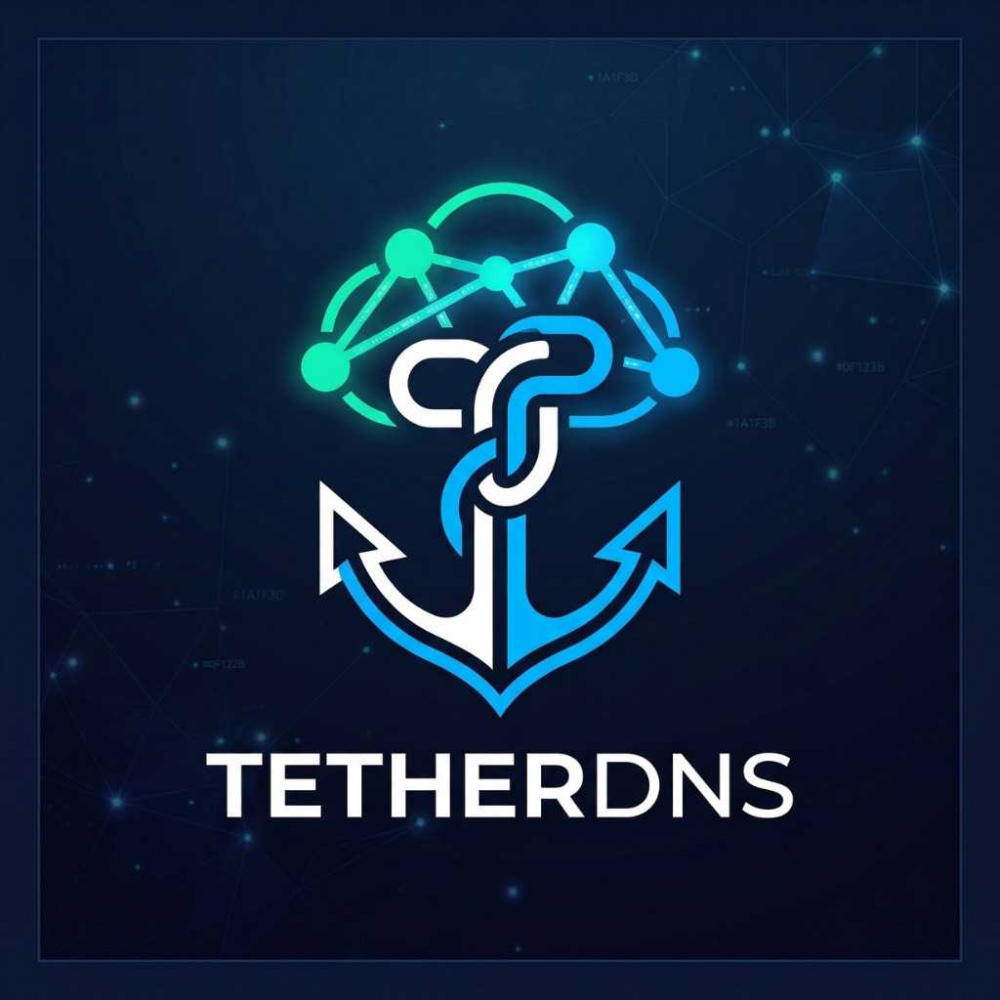
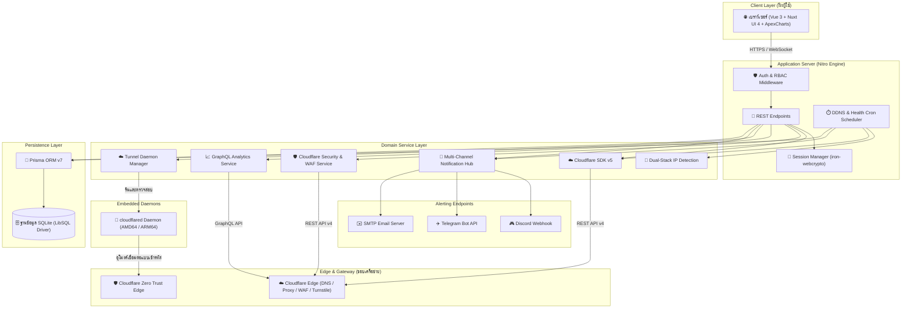

<div align="center">



# **TetherDNS**

### _ระบบจัดการ Cloudflare DNS, Dynamic IP, Zero Trust Tunnel และ Edge Security ครบวงจร_

<p align="center">
  <a href="https://nuxt.com/">
    
  </a>
  <a href="https://vuejs.org/">
    
  </a>
  <a href="https://tailwindcss.com/">
    
  </a>
  <a href="https://prisma.io/">
    
  </a>
  <a href="https://www.docker.com/">
    
  </a>
  <a href="https://developers.cloudflare.com/">
    
  </a>
</p>

**TetherDNS** คือเว็บแอปพลิเคชันแบบ Self-hosted ระดับองค์กร สำหรับการบริหารจัดการ Cloudflare DNS แบบครบวงจร, ระบบ Dynamic DNS (DDNS) อัตโนมัติ, ระบบ Cloudflare Zero Trust Tunnels ในตัว (ไม่ต้องติดตั้ง Sidecar แยก) พร้อมระบบวิเคราะห์ภัยคุกคาม (Threat Intelligence) และควบคุม WAF ได้จากจุดเดียว ภายใต้หน้าจอ Cyberpunk **Ocean Deep Tech** ระดับพรีเมียม

[English](README.md) • [ภาษาไทย](README-TH.md)

</div>

---

## 📋 สารบัญ

- [✨ ฟีเจอร์หลัก](#-ฟีเจอร์หลัก)
  - [🔐 ความปลอดภัยและการเข้าถึง](#-ความปลอดภัยและการเข้าถึง)
  - [🌍 จัดการบัญชีและ Cloudflare DNS](#-จัดการบัญชีและ-cloudflare-dns)
  - [🛡️ Cloudflare WAF และการควบคุมความปลอดภัย](#️-cloudflare-waf-และการควบคุมความปลอดภัย)
  - [📈 สถิติทราฟฟิกและการวิเคราะห์ภัยคุกคาม (Analytics)](#-สถิติทราฟฟิกและการวิเคราะห์ภัยคุกคาม-analytics)
  - [☁️ Cloudflare Tunnel ในตัว (Zero Trust)](#️-cloudflare-tunnel-ในตัว-zero-trust)
  - [🔄 ระบบ Dynamic DNS (DDNS) และ Failover](#-ระบบ-dynamic-dns-ddns-และ-failover)
  - [🔔 ระบบแจ้งเตือนหลายช่องทาง (Notification Hub)](#-ระบบแจ้งเตือนหลายช่องทาง-notification-hub)
  - [👥 การจัดการผู้ใช้และสิทธิ์ (RBAC)](#-การจัดการผู้ใช้และสิทธิ์-rbac)
  - [📊 บันทึกประวัติและ Audit Trail](#-บันทึกประวัติและ-audit-trail)
  - [🎨 การออกแบบและ UI/UX](#-การออกแบบและ-uiux)
- [🏗️ สถาปัตยกรรมระบบ](#️-สถาปัตยกรรมระบบ)
- [⚡ เริ่มต้นใช้งานอย่างรวดเร็ว](#-เริ่มต้นใช้งานอย่างรวดเร็ว)
  - [🐳 ใช้งานผ่าน Docker (แนะนำ)](#-ใช้งานผ่าน-docker-แนะนำ)
  - [💻 พัฒนาในเครื่อง (Local Development)](#-พัฒนาในเครื่อง-local-development)
- [⚙️ ตัวแปรและสภาพแวดล้อม (Environment Variables)](#️-ตัวแปรและสภาพแวดล้อม-environment-variables)
- [🔑 การสร้างและตั้งค่า Cloudflare API Token](#-การสร้างและตั้งค่า-cloudflare-api-token)
- [🚀 ตัวช่วยตั้งค่าเมื่อเริ่มใช้งานครั้งแรก (Setup Wizard)](#-ตัวช่วยตั้งค่าเมื่อเริ่มใช้งานครั้งแรก-setup-wizard)
- [📖 คู่มือการใช้งานอย่างละเอียด](#-คู่มือการใช้งานอย่างละเอียด)
  - [1. การจัดการบัญชี Cloudflare (Accounts)](#1-การจัดการบัญชี-cloudflare-accounts)
  - [2. การจัดการ DNS Zones และ Records](#2-การจัดการ-dns-zones-และ-records)
  - [3. การจัดการความปลอดภัยและ WAF ที่ขอบเครือข่าย](#3-การจัดการความปลอดภัยและ-waf-ที่ขอบเครือข่าย)
  - [4. การดูสถิติทราฟฟิกและภัยคุกคาม (Analytics)](#4-การดูสถิติทราฟฟิกและภัยคุกคาม-analytics)
  - [5. การใช้งาน Cloudflare Zero Trust Tunnels](#5-การใช้งาน-cloudflare-zero-trust-tunnels)
  - [6. การตั้งค่า DDNS และเชื่อมต่อกับเราเตอร์](#6-การตั้งค่า-ddns-และเชื่อมต่อกับเราเตอร์)
  - [7. การตั้งค่าระบบแจ้งเตือน (Notifications)](#7-การตั้งค่าระบบแจ้งเตือน-notifications)
  - [8. การตั้งค่าระบบและการเปิด 2FA](#8-การตั้งค่าระบบและการเปิด-2fa)
- [🔗 Webhook API](#-webhook-api)
- [🛠️ คำสั่ง Scripts (NPM Reference)](#️-คำสั่ง-scripts-npm-reference)
- [🔒 แนวทางความปลอดภัยสำหรับ Production](#-แนวทางความปลอดภัยสำหรับ-production)
- [📜 สัญญาอนุญาต](#-สัญญาอนุญาต)

---

## ✨ ฟีเจอร์หลัก

### 🔐 ความปลอดภัยและการเข้าถึง
- **Setup Wizard**: ตัวช่วยตั้งค่าครั้งแรกเมื่อฐานข้อมูลยังว่างเปล่า เพื่อกำหนดผู้ดูแลระบบอย่างปลอดภัย
- **Two-Factor Authentication (TOTP 2FA)**: มาตรฐานสากล RFC 6238 ผ่าน `otplib` รองรับการสแกน QR-code และรหัสผ่านสำรอง
- **Session ฝั่งเซิร์ฟเวอร์เข้ารหัส AES-256**: เข้ารหัสผ่าน `iron-webcrypto` ส่งผ่าน HTTP-only, SameSite Cookies ป้องกัน XSS
- **bcrypt Password Hashing**: เข้ารหัสรหัสผ่านด้วย `bcryptjs` พร้อม Salt — ไม่เก็บรหัสผ่านเป็นข้อความธรรมดาเด็ดขาด
- **ระบบสิทธิ์ผู้ใช้ (RBAC)**: รองรับการแยกบทบาท `ADMIN` (จัดการได้ทุกอย่าง) และ `VIEWER` (ดูข้อมูลอย่างเดียว)
- **Personal Access Tokens**: สร้าง API Token เพื่อนำไปเขียนสคริปต์ควบคุมระบบอัตโนมัติ

### 🌍 จัดการบัญชีและ Cloudflare DNS
- **Multi-Account Vault**: จัดการ Cloudflare API Accounts ได้ไม่จำกัดจำนวนจากหน้า Dashboard เดียว
- **จัดการ DNS Records ครบวงจร**: รองรับ `A`, `AAAA`, `CNAME`, `TXT`, `MX`, `NS`, `SRV`, และ `CAA`
- **ระบบเราติ้ง 3 โหมด (Tri-Mode Routing)**: สลับแต่ละ Record ได้ทันทีระหว่าง **Static (ค่าคงที่)**, **Dynamic IP (DDNS)** หรือ **Cloudflare Tunnel (Zero Trust)**
- **สลับสถานะ Cloudflare Proxy (☁️)**: เปิด/ปิดโหมด Proxy (เมฆสีส้ม) เพื่อใช้งาน CDN Caching, ป้องกัน DDoS และซ่อน IP แท้
- **ปรับแต่ง TTL ได้ยืดหยุ่น**: ตั้งแต่ `1` (Auto) จนถึงช่วงเวลามาตรฐานที่ต้องการ
- **Global DNS Propagation Checker**: ตรวจสอบการกระจายตัวของค่า DNS ไปยัง DNS Server ทั่วโลก (Cloudflare, Google, Quad9, OpenDNS)
- **นำเข้าและส่งออกไฟล์ BIND Zone**: รองรับการ Backup และ Restore ค่า DNS ในรูปแบบมาตรฐาน RFC 1035 ด้วยคลิกเดียว
- **Batch Record Actions**: เลือกลบหรือจัดการหลายๆ Record พร้อมกันได้อย่างรวดเร็ว

### 🛡️ Cloudflare WAF และการควบคุมความปลอดภัย
- **ปรับระดับความปลอดภัยของ Zone (Security Level)**: สลับโหมดความปลอดภัยได้ทันที: `Essentially Off`, `Low`, `Medium`, `High` และ `Under Attack` (I'm Under Attack Mode!)
- **Browser Integrity Check (BIC)**: สวิตช์เปิด/ปิดการตรวจจับ Header ที่ผิดปกติและบล็อกบอทหรือสแกนเนอร์อันตราย
- **Challenge TTL**: กำหนดระยะเวลาที่อนุญาตให้ผู้เข้าชมที่ผ่านการตรวจสอบ CAPTCHA/Challenge เข้าถึงเว็บได้โดยไม่ต้องตรวจสอบซ้ำ (5 นาที ถึง 1 ปี)
- **IP Access Rules (กฎไฟร์วอลล์)**:
  - **เป้าหมายที่รองรับ**: ไอพีเดี่ยว (`ip`), ช่วงไอพี Subnet CIDR (`ip_range`), หมายเลขระบบเครือข่าย (`asn`) และรหัสประเทศ (`country` พร้อมแสดงธงชาติ 🇹🇭 🇺🇸 🇯🇵)
  - **รูปแบบการจัดการ (Action Modes)**: `Block` (บล็อก), `Managed Challenge` (Cloudflare Turnstile), `Challenge` (แคปช่าโต้ตอบ), `JS Challenge` (จาวาสคริปต์ตรวจสอบ) และ `Whitelist` (อนุญาตพิเศษ)
  - ระบบค้นหาและบันทึกหมายเหตุ (Notes) สำหรับแต่ละกฎเพื่อใช้อ้างอิง
- **WAF Custom Rules**: ตรวจสอบและเปิด/ปิดกฎไฟร์วอลล์แบบกำหนดเองของ Cloudflare ได้โดยตรง
- **Quick Security Modal**: หน้าต่างควบคุมความปลอดภัยแบบด่วนบนแถบนำทางและหัว Zone ให้คุณกดรับมือการโจมตี DDoS หรือบล็อกไอพีได้ทันท่วงทีจากทุกหน้า

### 📈 สถิติทราฟฟิกและการวิเคราะห์ภัยคุกคาม (Analytics)
- **ดึงสถิติจาก Cloudflare GraphQL Analytics API โดยตรง**: แสดงข้อมูลความเร็วสูงที่ประมวลผล ณ Edge ของ Cloudflare
- **เลือกช่วงเวลาย้อนหลังได้**: ดูข้อมูลย้อนหลัง **24 ชั่วโมง**, **7 วัน** หรือ **30 วัน**
- **ดัชนีชี้วัดสำคัญ (KPIs)**: ปริมาณ Request ทั้งหมด, สัดส่วนการแคช (Cached Ratio), ปริมาณ Bandwidth, ผู้เข้าชมที่ไม่ซ้ำ (Unique Visitors) และจำนวนภัยคุกคามที่ถูกสกัดกั้น
- **แผนภูมิแบบ Interactive (ApexCharts)**:
  - กราฟ Time-series แสดงปริมาณ Request เทียบระหว่างข้อมูลที่แคชและไม่แคช
  - ปริมาณการใช้งาน Bandwidth
  - สถิติภัยคุกคามแยกตาม Action (Block, Challenge, JS Challenge, Managed Challenge)
  - แผนภูมิโดนัทแสดงรหัสสถานะ HTTP (`2xx`, `3xx`, `4xx`, `5xx`)
- **ตารางสรุปประเทศต้นทางของภัยคุกคาม (Top Threat Countries)**: จัดอันดับประเทศที่ส่งทราฟฟิกอันตรายเข้ามามากที่สุดพร้อมธงชาติประกอบ

### ☁️ Cloudflare Tunnel ในตัว (Zero Trust)
- **Embedded Daemon ในตัว**: รวมโปรแกรม `cloudflared` ดั้งเดิมไว้ใน Docker Container โดยตรง ไม่ต้องดึง Image อื่นหรือรัน Sidecar เพิ่มเติม
- **รองรับ Multi-Architecture**: ใช้งานได้ทั้งบนสถาปัตยกรรม `amd64` (x86_64) และ `arm64` (aarch64) โดยอัตโนมัติ
- **จัดการ Tunnel ครบวงจร**: สร้าง, ปรับแต่ง, รัน และลบ Zero Trust Tunnel จากหน้าจอเว็บได้ทันที
- **Auto-Start & Reconnect**: สตาร์ตอุโมงค์ที่เปิดใช้งานไว้อัตโนมัติเมื่อ Container เริ่มทำงาน พร้อมระบบลองเชื่อมต่อใหม่เมื่อหลุด
- **ดูบันทึกสดแบบ Live Logs**: สตรีมข้อมูลการเชื่อมต่อและข้อผิดพลาดจากตัวโปรเซส `cloudflared` ขึ้นมาดูบนเบราว์เซอร์ได้ทันที
- **Two-Way Reconciliation Sync**: ตรวจจับความเปลี่ยนแปลงบน Cloudflare Dashboard และเคลียร์รายการที่ถูกลบออกจากฐานข้อมูลอัตโนมัติ

### 🔄 ระบบ Dynamic DNS (DDNS) และ Failover
- **ตรวจจับไอพีแบบ Dual-Stack**: ตรวจสอบทั้ง IPv4 และ IPv6 สาธารณะพร้อมกันผ่านผู้ให้บริการภายนอกที่มีเสถียรภาพสูง
- **Background Cron Scheduler**: ตรวจสอบและอัปเดตการเปลี่ยนแปลงของไอพีตามช่วงเวลาที่กำหนด (ค่าเริ่มต้น: ทุก 5 นาที)
- **เลือกเปิด DDNS ราย Record**: กำหนดให้ติดตามเฉพาะ Record `A` หรือ `AAAA` ที่ต้องการได้อย่างอิสระ
- **Webhook API สำหรับเราเตอร์**: มี URL และ Token เข้ารหัสเฉพาะตัว สำหรับตั้งค่าในเราเตอร์ เช่น pfSense, OPNsense, OpenWrt, DD-WRT หรือสคริปต์ภายนอก
- **Healthcheck & Failover**: มอนิเตอร์สถานะ Endpoint ปลายทาง หากระบบล่มจะสลับไปใช้ IP สำรองให้อัตโนมัติ

### 🔔 ระบบแจ้งเตือนหลายช่องทาง (Notification Hub)
- **Discord Webhook**: การ์ดข้อความ Embed สีสันสวยงาม พร้อมรูปบอทและระบบ Tag Mention บทบาท
- **Telegram Bot**: ส่งข้อความแจ้งเตือนผ่านบอท รองรับทั้งกลุ่ม, ห้องแชทส่วนตัว, Supergroup Topic ID และโหมดแจ้งเตือนแบบเงียบ
- **Email (SMTP)**: ส่งอีเมลแจ้งเตือนผ่าน Gmail หรือ SMTP Server ส่วนตัว รองรับการเข้ารหัส SSL/TLS
- **เลือกรับการแจ้งเตือนตามเหตุการณ์**:
  - `DDNS`: แจ้งเตือนเมื่อไอพีบ้านเปลี่ยนและอัปเดตลง Cloudflare สำเร็จ
  - `FAILOVER`: แจ้งเตือนเมื่อ Endpoint ปลายทางไม่ตอบสนองหรือสลับ IP สำรอง
  - `TUNNEL`: แจ้งเตือนเมื่อ Tunnel เชื่อมต่อสำเร็จ หลุดการเชื่อมต่อ หรือเกิดข้อผิดพลาด
  - `SECURITY`: แจ้งเตือนเมื่อมีการเพิ่ม/แก้กฎ WAF, ปรับระดับความปลอดภัย หรือมีการล็อกอินเข้าสู่ระบบ
- **ปุ่มทดสอบการส่ง (Test)**: สามารถกดทดสอบการยิงข้อความในแต่ละช่องทางได้ทันทีจากหน้าจอ

### 👥 การจัดการผู้ใช้และสิทธิ์ (RBAC)
- จัดการบัญชีผู้ดูแลและสมาชิกในองค์กร
- กำหนดสิทธิ์ `ADMIN` (จัดการระบบเต็มรูปแบบ) หรือ `VIEWER` (ดูข้อมูลอย่างเดียว)
- ติดตามวันเวลาที่สร้างบัญชี วันที่เข้าใช้งานล่าสุด และเปิด/ปิดการใช้งานบัญชีได้

### 📊 บันทึกประวัติและ Audit Trail
- **Audit Log (`/audit`)**: บันทึกการกระทำทุกอย่างของผู้ใช้และระบบที่ไม่สามารถแก้ไขได้ เช่น การเข้าสู่ระบบ, การแก้ไข DNS, การปรับ WAF, การเปิด Tunnel
- **DDNS Log (`/logs`)**: หน้าต่างสรุปประวัติการอัปเดต DDNS โดยเฉพาะ แสดงเปรียบเทียบไอพีเดิมและไอพีใหม่ พร้อมเวลาที่ใช้ในการประมวลผล

### 🎨 การออกแบบและ UI/UX
- **ธีม Ocean Deep Tech Cyberpunk**: โทนสีมืดสไตล์ Glassmorphism ออกแบบมาเพื่อถนอมสายตาสำหรับผู้ดูแลระบบที่ต้องเฝ้าระวังหน้าจอนานๆ
- **Categorized Mega-Dropdown Navbar**: แถบนำทางจัดหมวดหมู่ชัดเจน ทั้ง Domains, Security & WAF, Analytics, Tunnels, Audit Logs และ Settings
- **รองรับ 2 ภาษาเต็มรูปแบบ**: สลับใช้งานได้ทันทีระหว่าง **ภาษาไทย 🇹🇭** และ **ภาษาอังกฤษ 🇬🇧** ผ่าน `@nuxtjs/i18n`

---

## 🏗️ สถาปัตยกรรมระบบ



### รายการเทคโนโลยีหลักที่ใช้งาน

| หมวดหมู่ | เทคโนโลยี | คำอธิบาย |
|---|---|---|
| **Frontend Framework** | [Nuxt 4](https://nuxt.com/) & [Vue 3](https://vuejs.org/) | Full-stack Vue Framework ทำงานด้วย Composition API และ Vite |
| **Component System** | [@nuxt/ui v4](https://ui.nuxt.com/) & [Tailwind CSS](https://tailwindcss.com/) | ชุด UI Components สไตล์ Cyberpunk ที่ทันสมัย |
| **Server Engine** | [Nitro](https://nitro.build/) | Server Runtime ประสิทธิภาพสูงที่มาพร้อมกับ Nuxt |
| **Database ORM** | [Prisma v7](https://prisma.io/) (`@prisma/adapter-libsql`) | ระบบจัดการฐานข้อมูลแบบ Type-safe พร้อม Adapter ของ LibSQL |
| **Database Engine** | SQLite (LibSQL) | ฐานข้อมูลแบบไฟล์เดียว ไม่ต้องติดตั้ง Server ภายนอก |
| **Cloudflare Client** | [`cloudflare` v5](https://github.com/cloudflare/cloudflare-typescript) | Official TypeScript SDK จาก Cloudflare |
| **Authentication** | `nuxt-auth-utils` + `bcryptjs` + `otplib` | เข้ารหัส Session, Hash รหัสผ่าน และระบบ 2FA |
| **Data Visualizations** | [ApexCharts](https://apexcharts.com/) + `vue3-apexcharts` | แผนภูมิกราฟสถิติทราฟฟิกและภัยคุกคามแบบ Interactive |
| **Zero Trust Daemon** | [`cloudflared`](https://github.com/cloudflare/cloudflared) | โปรแกรมรันอุโมงค์ Zero Trust ในตัว |
| **Email Transporter** | [Nodemailer](https://nodemailer.com/) | ไคลเอ็นต์ส่งอีเมล SMTP ปลอดภัย รองรับ SSL/TLS |
| **ระบบสองภาษา (i18n)** | [`@nuxtjs/i18n`](https://i18n.nuxtjs.org/) | สลับภาษาไทย 🇹🇭 และอังกฤษ 🇬🇧 ได้อย่างไร้รอยต่อ |

---

## ⚡ เริ่มต้นใช้งานอย่างรวดเร็ว

### 🐳 ใช้งานผ่าน Docker (แนะนำ)

เป็นวิธีที่สะดวกและพร้อมใช้งานสำหรับ Production มากที่สุด โดยต้องการ [Docker](https://docs.docker.com/get-docker/) และ [Docker Compose](https://docs.docker.com/compose/)

#### 1. ทำการ Clone Repository
```bash
git clone https://github.com/riiixch/TetherDNS.git
cd TetherDNS
```

#### 2. สร้างไฟล์ Environment
```bash
cp .env.example .env
```
เปิดไฟล์ `.env` และตั้งค่าตัวแปร `SESSION_PASSWORD` ด้วยข้อความสุ่มที่ปลอดภัยและมีความยาว **อย่างน้อย 32 ตัวอักษร**:
```bash
# สุ่มคีย์ความยาว 32+ ตัวอักษรด้วย openssl
openssl rand -base64 48
```

#### 3. สั่ง Build และรัน Container
```bash
docker compose up -d --build
```

Container จะทำการ Sync ตารางฐานข้อมูลให้อัตโนมัติ (`./node_modules/.bin/prisma db push --accept-data-loss`) และเปิดระบบพร้อมใช้งานทันที

#### 4. เปิดเข้าใช้งานแอปพลิเคชัน
เปิดเบราว์เซอร์ไปที่:
```
http://localhost:3000
```
เมื่อเปิดครั้งแรก ระบบจะนำคุณไปยังหน้า **Setup Wizard** เพื่อสร้างบัญชีผู้ดูแลระบบคนแรก

---

### คำสั่ง Docker ที่ใช้บ่อย

```bash
# ดู Log สดของการทำงานแอปและ Tunnel
docker compose logs -f tetherdns

# สั่งรีสตาร์ทแอปพลิเคชัน
docker compose restart tetherdns

# สั่งหยุดการทำงาน
docker compose down

# อัปเดตแอปเป็นเวอร์ชันล่าสุด
git pull
docker compose down
docker compose up -d --build
```

---

### 💻 พัฒนาในเครื่อง (Local Development)

สำหรับผู้ที่ต้องการร่วมพัฒนาโค้ดหรือปรับแต่ง TetherDNS

**สิ่งที่ต้องมีในเครื่อง:**
- [Node.js](https://nodejs.org/) v20.x ขึ้นไป
- [npm](https://www.npmjs.com/) v10.x ขึ้นไป

```bash
# 1. Clone และติดตั้ง Dependencies
git clone https://github.com/riiixch/TetherDNS.git
cd TetherDNS
npm install

# 2. ตั้งค่าไฟล์ Environment
cp .env.example .env
# เปิดไฟล์ .env แล้วใส่ค่า SESSION_PASSWORD

# 3. ซิงค์ตารางฐานข้อมูล SQLite
npm run prisma:push

# 4. สตาร์ท Dev Server
npm run dev
```

เปิดใช้งานได้ที่ `http://localhost:3000` โดยมี Hot Module Replacement (HMR) ทำงานตลอดเวลา

> **💡 หมายเหตุสำหรับการทดสอบ Tunnel ในเครื่อง:**
> หากต้องการทดสอบรันอุโมงค์ Zero Trust บนเครื่องตัวเอง (Local) คุณจำเป็นต้องมีโปรแกรม `cloudflared` ติดตั้งอยู่ใน System PATH ของระบบปฏิบัติการ แต่หากรันผ่าน Docker ระบบจะมีติดตั้งไว้ให้แล้วใน Container โดยอัตโนมัติ

---

## ⚙️ ตัวแปรและสภาพแวดล้อม (Environment Variables)

กำหนดค่าตัวแปรใน `docker-compose.yml` หรือไฟล์ `.env`:

| ตัวแปร | บังคับ | ค่าเริ่มต้น | คำอธิบาย |
|---|---|---|---|
| `DATABASE_URL` | ✅ ใช่ | `file:/app/data/tetherdns.db` | ที่ตั้งไฟล์ SQLite แนะนำให้ Mount เป็น Volume ไว้นอก Container เพื่อไม่ให้ข้อมูลหาย |
| `SESSION_PASSWORD` | ✅ ใช่ | _(ไม่มี)_ | **ต้องยาวอย่างน้อย 32 ตัวอักษร** คีย์ลับสำหรับเข้ารหัส Session |
| `SESSION_SECURE` | ✅ ใช่ | `false` | ตั้งเป็น `true` หากรันระบบหลัง HTTPS Reverse Proxy เพื่อบังคับความปลอดภัย Cookie |
| `NODE_ENV` | ✅ ใช่ | `production` | โหมดการทำงาน (`production` หรือ `development`) |
| `TZ` | ไม่ | `Asia/Bangkok` | เขตเวลาของเซิร์ฟเวอร์สำหรับบันทึก Log (เช่น `Asia/Bangkok`, `UTC`) |
| `PORT` | ไม่ | `3000` | พอร์ตที่แอปพลิเคชันเปิดรับฟัง |
| `HOST` | ไม่ | `0.0.0.0` | Network Interface ที่ผูกรับการเชื่อมต่อ |

### ตัวอย่างไฟล์ `docker-compose.yml`

```yaml
services:
  tetherdns:
    build: .
    image: tetherdns:latest
    container_name: tetherdns
    restart: always
    volumes:
      - ./data:/app/data
    environment:
      - DATABASE_URL=file:/app/data/tetherdns.db
      - SESSION_PASSWORD=change-me-to-a-strong-secret-key-32chars-minimum
      - SESSION_SECURE=false # ตั้งเป็น true เมื่อใช้งานผ่าน HTTPS
      - NODE_ENV=production
      - TZ=Asia/Bangkok
    ports:
      - "3000:3000"
    command: sh -c "./node_modules/.bin/prisma db push --accept-data-loss && node .output/server/index.mjs"
```

---

## 🔑 การสร้างและตั้งค่า Cloudflare API Token

TetherDNS เชื่อมต่อกับ Cloudflare ผ่าน **API Token** แบบกำหนดสิทธิ์จำเพาะ

ขั้นตอนการสร้าง Token:
1. เข้าสู่ระบบ [Cloudflare Dashboard](https://dash.cloudflare.com/)
2. ไปที่ **My Profile** → **API Tokens** → **Create Token**
3. เลือก **Create Custom Token** และตั้งค่าสิทธิ์ (Permissions) ดังนี้:

| ขอบเขต (Context) | ทรัพยากร (Resource) | สิทธิ์ (Permission) | วัตถุประสงค์การใช้งาน |
|---|---|---|---|
| **Zone** | **DNS** | **Edit** | สร้าง, แก้ไข และลบ DNS Records |
| **Zone** | **Zone** | **Read** | ดึงรายชื่อโดเมนและข้อมูล Metadata ของ Zone |
| **Zone** | **Zone Settings** | **Edit** | ปรับระดับ Security Level, BIC, Challenge TTL |
| **Zone** | **Firewall Services** | **Edit** | เพิ่ม, ลิสต์ และลบกฎ IP Access Rules |
| **Zone** | **Analytics** | **Read** | ดึงสถิติทราฟฟิกและภัยคุกคามผ่าน GraphQL |
| **Account** | **Cloudflare Tunnel** | **Edit** | สร้าง, ตั้งค่า และสั่งรัน Zero Trust Tunnels |
| **Account** | **Account Settings** | **Read** | ตรวจสอบ Account ID และชื่อบัญชี |

4. ในส่วน **Zone Resources** ให้เลือก **All zones** (หรือเลือกเฉพาะโดเมนที่ต้องการจัดการ)
5. คลิก **Continue to summary** → **Create Token** แล้วคัดลอก Token มาใส่ใน TetherDNS

---

## 🚀 ตัวช่วยตั้งค่าเมื่อเริ่มใช้งานครั้งแรก (Setup Wizard)

เมื่อเปิด TetherDNS ขึ้นมาโดยที่ยังไม่มีข้อมูลในระบบ จะถูกส่งไปยังหน้า `/setup`:

1. **สร้างบัญชีผู้ดูแลระบบ**: ตั้งชื่อผู้ใช้ (Username) และรหัสผ่านหลัก (Password)
2. **เข้าสู่ระบบ**: ล็อกอินเข้าสู่หน้าหลัก
3. **เชื่อมต่อบัญชี Cloudflare**: ไปที่หน้า **Accounts** → **+ Add Account** แล้วใส่ API Token ของคุณ
4. **เปิดใช้งาน 2FA (แนะนำ)**: ไปที่ **Settings** → **Security** เพื่อสแกน QR Code ผูกกับแอปยืนยันตัวตน (Google Authenticator, Authy, Bitwarden)

---

## 📖 คู่มือการใช้งานอย่างละเอียด

### 1. การจัดการบัญชี Cloudflare (Accounts)
- เพิ่มบัญชี Cloudflare ได้หลายบัญชี พร้อมตั้งชื่อจำง่าย (เช่น `บัญชีบริษัท`, `โดเมนส่วนตัว`)
- ระบบจะตรวจสอบความถูกต้องของ Token ทันที และซิงค์รายชื่อโดเมนทั้งหมดมาแสดง

### 2. การจัดการ DNS Zones และ Records
เข้าไปที่เมนู **Zones** เพื่อจัดการโดเมน:
- **ค้นหาและกรองข้อมูล**: ค้นหา Record ตามชื่อ, ปลายทาง หรือประเภท Record
- **สลับโหมดการชี้เส้นทาง (Routing Modes)**:
  - `Static`: ชี้ไปยังไอพีหรือโฮสต์คงที่ทั่วไป
  - `Dynamic DNS (DDNS)`: ให้ระบบคอยตรวจสอบและอัปเดตไอพีสาธารณะให้อัตโนมัติเมื่อไอพีเปลี่ยน
  - `Cloudflare Tunnel`: ผูกเข้ากับอุโมงค์ Zero Trust ส่งตรงไปยังเครื่องเซิร์ฟเวอร์ภายในบ้าน
- **สลับเปิด/ปิด Proxy (☁️)**: เปิด/ปิดการทำงานของ Cloudflare Proxy ราย Record
- **ตรวจสอบการกระจายตัว (Propagation Check)**: คลิกที่ไอคอนตรวจสอบเพื่อดูว่า DNS กระจายไปยังผู้ให้บริการทั่วโลกแล้วหรือยัง
- **นำเข้า/ส่งออก BIND Zone**: สามารถดาวน์โหลดไฟล์ Zone มาสำรองไว้ หรืออัปโหลดไฟล์ BIND Zone เข้ามาได้ทันที

### 3. การจัดการความปลอดภัยและ WAF ที่ขอบเครือข่าย
ในหน้าของแต่ละ Zone ให้คลิกไปที่แท็บ **Security & WAF**:
- **การตั้งค่าความปลอดภัยทั่วไป (Security Overview)**:
  - **Security Level**: ปรับระดับได้ตั้งแต่ `Essentially Off`, `Low`, `Medium`, `High` และ `Under Attack`
  - **Browser Integrity Check**: เปิด/ปิดการคัดกรอง Header ผิดปกติ
  - **Challenge TTL**: เลือกระยะเวลาจำค่าการผ่าน Challenge ของผู้เข้าชม
- **กฎไฟร์วอลล์ (IP Access Rules)**:
  - คลิก **+ Add IP Rule**
  - เลือกประเภทเป้าหมาย: IP เดี่ยว, Subnet CIDR, ASN หรือรหัสประเทศ 2 ตัวอักษร
  - เลือกการกระทำ: `Block`, `Managed Challenge`, `Challenge`, `JS Challenge` หรือ `Whitelist`
  - ใส่หมายเหตุประกอบเหตุผลเพื่อใช้อ้างอิงภายหลัง
- **หน้าต่างฉุกเฉินด่วน (Quick Security Modal)**:
  - คลิกที่ **ไอคอนโล่ (🛡️)** บนแถบนำทางหรือบนหัวหน้า Zone
  - สามารถสลับเปิด **Under Attack Mode** ได้ทันทีในคลิกเดียวโดยไม่ต้องสลับหน้าจอไปมา

### 4. การดูสถิติทราฟฟิกและภัยคุกคาม (Analytics)
คลิกที่เมนู **Analytics** บนแถบนำทาง:
- เลือกโดเมนและช่วงเวลาที่ต้องการดู (`24 ชั่วโมง`, `7 วัน` หรือ `30 วัน`)
- ตรวจสอบอัตราการแคช (Cache Hit Ratio), ปริมาณการประหยัด Bandwidth และจำนวนผู้เข้าชม
- ตรวจสอบแนวโน้มภัยคุกคามและการกระจายตัวของรหัสสถานะ HTTP
- ดูตารางประเทศที่เป็นแหล่งกำเนิดของการโจมตีมากที่สุด

### 5. การใช้งาน Cloudflare Zero Trust Tunnels
ไปที่เมนู **Tunnels**:
- **สร้าง Tunnel**: ตั้งชื่อ Tunnel ระบบจะส่งไปขึ้นทะเบียนกับ Cloudflare ให้อัตโนมัติ
- **เปิดการทำงาน (Run Daemon)**: สลับสวิตช์ **Daemon Run** เป็น **Active** ตัวรันใน Container จะเริ่มทำงานทันที
- **ดูบันทึกสด (Live Logs)**: กดปุ่ม **Logs** เพื่อดูข้อมูลการ Handshake ของโปรเซส `cloudflared` แบบ Real-time
- **ผูกเข้ากับ Record**: ในหน้าจัดการ DNS Record ให้เลือก Routing Mode เป็น **Cloudflare Tunnel**, เลือกชื่อ Tunnel และระบุพอร์ตปลายทาง เช่น `http://localhost:8080`

### 6. การตั้งค่า DDNS และเชื่อมต่อกับเราเตอร์
- เปิดสวิตช์ **DDNS** บน Record ประเภท `A` (IPv4) หรือ `AAAA` (IPv6) ที่ต้องการ
- ระบบจะคอยเช็คไอพีผ่าน Cron Job และอัปเดตให้เมื่อพบว่าไอพีของบ้านเปลี่ยนไป
- สำหรับผู้ที่ต้องการให้อัปเดตทันทีที่เราเตอร์ต่อเน็ตใหม่ สามารถนำ Webhook URL ไปใส่ในเราเตอร์ได้ทันที

### 7. การตั้งค่าระบบแจ้งเตือน (Notifications)
ไปที่หน้า **Settings** → **Notifications**:
- **Discord**: วาง Webhook URL, ตั้งชื่อและรูปบอท พร้อมกำหนด Role Mention
- **Telegram**: ระบุ Bot Token และ Chat ID (รองรับ Topic ID สำหรับกลุ่มแบบแบ่งห้อง)
- **Email**: เลือก Gmail หรือกรอกข้อมูล SMTP Server ส่วนตัวพร้อมรหัสผ่าน
- **เลือกเหตุการณ์**: ติ๊กเลือกเหตุการณ์ที่ต้องการรับการแจ้งเตือน (`DDNS`, `FAILOVER`, `TUNNEL`, `SECURITY`)
- **ทดสอบส่งข้อความ**: กดปุ่ม **Test** เพื่อทดสอบยิงข้อความไปยังช่องทางนั้นๆ

### 8. การตั้งค่าระบบและการเปิด 2FA
- เปลี่ยนชื่อผู้ใช้และรหัสผ่านของผู้ดูแลระบบ
- เปิดใช้งาน **Two-Factor Authentication** เพื่อความปลอดภัยสูงสุด
- สลับภาษาการแสดงผลระหว่าง **ภาษาไทย** และ **ภาษาอังกฤษ** ผ่านไอคอนลูกโลก 🌐 บนแถบนำทาง

---

## 🔗 Webhook API

TetherDNS มี Endpoint สำหรับให้เราเตอร์หรือสคริปต์ภายนอกสั่งอัปเดต DDNS ได้ทันที

### Endpoint
```http
GET /api/webhook/ddns?token=<YOUR_SECRET_TOKEN>
```

### การดู Token ของคุณ
1. ไปที่เมนู **Settings** → **Webhook**
2. คัดลอก Token (หรือกดปุ่มสร้างใหม่หากต้องการยกเลิกของเดิม)

### ตัวอย่างการเรียกใช้งาน

#### เรียกผ่าน cURL
```bash
curl -X GET "http://your-server:3000/api/webhook/ddns?token=YOUR_TOKEN_HERE"
```

#### ตั้งใน Crontab (ทุก 10 นาที)
```bash
*/10 * * * * /usr/bin/curl -s "http://your-server:3000/api/webhook/ddns?token=YOUR_TOKEN_HERE" > /dev/null 2>&1
```

#### ตั้งค่าในเราเตอร์ (pfSense / OPNsense / OpenWrt / DD-WRT)
ระบุ URL ในช่อง Custom DDNS ของเราเตอร์ดังนี้:
```
http://your-server:3000/api/webhook/ddns?token=YOUR_TOKEN_HERE
```

#### ตัวอย่างผลลัพธ์ (JSON Response)
```json
{
  "success": true,
  "updated": 2,
  "timestamp": "2026-11-15T12:00:00.000Z"
}
```

---

## 🛠️ คำสั่ง Scripts (NPM Reference)

รันคำสั่งต่างๆ ด้วย `npm run <script>`:

| Script | คำสั่ง | คำอธิบาย |
|---|---|---|
| `dev` | `nuxt dev` | สตาร์ท Development Server พร้อม HMR |
| `build` | `nuxt build` | คอมไพล์แอปพลิเคชันสำหรับ Production |
| `preview` | `nuxt preview` | พรีวิวผลลัพธ์ของ Production Build บนเครื่อง |
| `generate` | `nuxt generate` | สร้างไฟล์ Static (SSG) |
| `prisma:gen` | `prisma generate` | สร้าง Prisma Client ใหม่ตามไฟล์ `schema.prisma` |
| `prisma:push` | `prisma db push --accept-data-loss` | ซิงค์โครงสร้างตารางไปยังฐานข้อมูล SQLite ทันที |
| `prisma:reset` | `prisma migrate reset` | ⚠️ **อันตราย!** ล้างข้อมูลทั้งหมดและรีเซ็ตฐานข้อมูลใหม่ |
| `update:check` | `npx npm-check-updates` | ตรวจสอบ Dependencies เวอร์ชันใหม่ |
| `update:install` | `npx npm-check-updates -u && npm install` | อัปเกรด Dependencies ทั้งหมดเป็นรุ่นล่าสุด |

---

## 🔒 แนวทางความปลอดภัยสำหรับ Production

1. **ใช้งานผ่าน HTTPS เสมอ**: รัน TetherDNS หลัง Reverse Proxy (เช่น Caddy, Traefik, Nginx) พร้อมเปิด SSL/TLS และตั้งค่า `SESSION_SECURE=true`
2. **สร้าง Session Key ที่แข็งแกร่ง**: ตั้งค่า `SESSION_PASSWORD` ให้มีความยาวอย่างน้อย 32-48 ตัวอักษรแบบสุ่ม
3. **เปิดใช้งาน TOTP 2FA**: ปกป้องบัญชี Admin จากการถูกสุ่มรหัสผ่านหรือขโมยข้อมูลเข้าสู่ระบบ
4. **กำหนดสิทธิ์ Token ให้พอดี**: เมื่อสร้าง Cloudflare API Token ให้จำกัดสิทธิ์เฉพาะ Zone ที่ต้องการบริหารจัดการเท่านั้น
5. **ป้องกันการเข้าถึงพอร์ตโดยตรง**: ปิดหรือจำกัดพอร์ต `3000` ให้อยู่เฉพาะในเครือข่ายภายในหรือ Localhost อย่าเปิดรับทราฟฟิก HTTP ตรงจากอินเทอร์เน็ตภายนอก

---

## 📜 สัญญาอนุญาต

เผยแพร่ภายใต้สัญญาอนุญาต **MIT License** ดูรายละเอียดเพิ่มเติมได้ในไฟล์ [LICENSE](./LICENSE)

---

<div align="center">

### 🌊 Master Your Network. Command the Deep.

**สร้างสรรค์ด้วยความใส่ใจในทุกรายละเอียด โดย [RIIIXCH](https://github.com/riiixch)**

</div>
