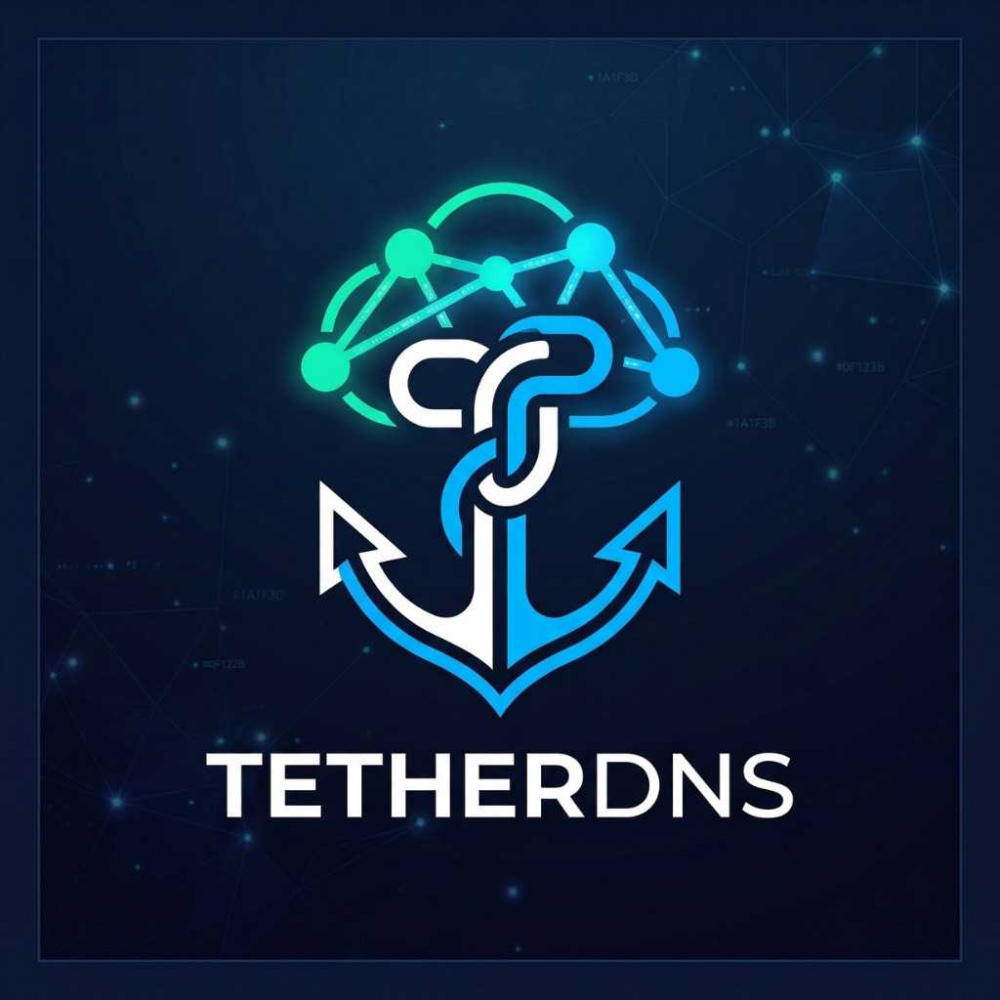
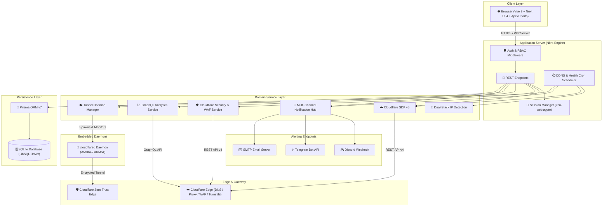

<div align="center">



# **TetherDNS**

### _Precision Cloudflare DNS, Dynamic IP, Zero Trust & Security Orchestrator_

<p align="center">
  <a href="https://nuxt.com/">
    
  </a>
  <a href="https://vuejs.org/">
    
  </a>
  <a href="https://tailwindcss.com/">
    
  </a>
  <a href="https://prisma.io/">
    
  </a>
  <a href="https://www.docker.com/">
    
  </a>
  <a href="https://developers.cloudflare.com/">
    
  </a>
</p>

**TetherDNS** is a self-hosted, enterprise-grade web application for full-lifecycle Cloudflare DNS management, automated Dynamic DNS (DDNS), embedded Cloudflare Zero Trust Tunnels, and real-time WAF & Threat Intelligence. It transforms complex network routing, edge security, and edge monitoring into an effortless, unified control center wrapped in a cyberpunk **Ocean Deep Tech** UI.

[English](README.md) • [ภาษาไทย](README-TH.md)

</div>

---

## 📋 Table of Contents

- [✨ Core Features](#-core-features)
  - [🔐 Security & Access Control](#-security--access-control)
  - [🌍 Multi-Account & Cloudflare DNS Management](#-multi-account--cloudflare-dns-management)
  - [🛡️ Cloudflare WAF & Security Controls](#️-cloudflare-waf--security-controls)
  - [📈 Traffic Analytics & Threat Intelligence](#-traffic-analytics--threat-intelligence)
  - [☁️ Embedded Cloudflare Tunnel (Zero Trust)](#️-embedded-cloudflare-tunnel-zero-trust)
  - [🔄 Dynamic DNS (DDNS) & Failover Engine](#-dynamic-dns-ddns--failover-engine)
  - [🔔 Multi-Channel Notification Hub](#-multi-channel-notification-hub)
  - [👥 User Management & RBAC](#-user-management--rbac)
  - [📊 Audit Trail & Logging](#-audit-trail--logging)
  - [🎨 Design & UX](#-design--ux)
- [🏗️ System Architecture](#️-system-architecture)
- [⚡ Quick Start](#-quick-start)
  - [🐳 Docker Deployment (Recommended)](#-docker-deployment-recommended)
  - [💻 Local Development](#-local-development)
- [⚙️ Configuration & Environment Variables](#️-configuration--environment-variables)
- [🔑 Cloudflare API Token Setup](#-cloudflare-api-token-setup)
- [🚀 First-Time Setup Wizard](#-first-time-setup-wizard)
- [📖 Detailed Usage Guide](#-detailed-usage-guide)
  - [1. Account Management](#1-account-management)
  - [2. DNS Zone & Record Operations](#2-dns-zone--record-operations)
  - [3. Edge Security & WAF Operations](#3-edge-security--waf-operations)
  - [4. Traffic & Threat Analytics](#4-traffic--threat-analytics)
  - [5. Zero Trust Cloudflare Tunnels](#5-zero-trust-cloudflare-tunnels)
  - [6. DDNS & Router Automation](#6-ddns--router-automation)
  - [7. Alerting & Notification Integrations](#7-alerting--notification-integrations)
  - [8. System Settings & TOTP 2FA](#8-system-settings--totp-2fa)
- [🔗 Webhook API](#-webhook-api)
- [🛠️ NPM Scripts Reference](#️-npm-scripts-reference)
- [🔒 Production Security Guidelines](#-production-security-guidelines)
- [📜 License](#-license)

---

## ✨ Core Features

### 🔐 Security & Access Control
- **First-Run Wizard**: Automated setup flow on initial boot to initialize admin credentials safely.
- **Two-Factor Authentication (TOTP 2FA)**: Standard RFC 6238 time-based one-time password security via `otplib` with QR-code enrollment and emergency recovery.
- **Encrypted Server-Side Sessions**: State encrypted using AES-256-GCM via `iron-webcrypto` with HTTP-only, SameSite cookies.
- **bcrypt Password Hashing**: Passwords salted and hashed with battle-tested `bcryptjs` — zero plaintext persistence.
- **Granular RBAC**: Multi-tenant architecture supporting `ADMIN` and `VIEWER` roles.
- **API Access Tokens**: Scoped personal access tokens for programmatic headless access.

### 🌍 Multi-Account & Cloudflare DNS Management
- **Multi-Account Vault**: Manage unlimited Cloudflare accounts and API tokens from a single unified pane.
- **Comprehensive DNS Record CRUD**: Full support for `A`, `AAAA`, `CNAME`, `TXT`, `MX`, `NS`, `SRV`, and `CAA` records.
- **Tri-Mode Routing**: Instantly switch any record between **Static (Manual)**, **Dynamic IP (DDNS)**, and **Cloudflare Tunnel (Zero Trust)**.
- **Cloudflare Proxy Toggle**: One-click Orange Cloud (☁️) toggle for CDN caching, DDoS protection, and IP masking.
- **Flexible TTL Controls**: Set TTL from `1` (Auto) to custom granular intervals.
- **Global DNS Propagation Checker**: Verify live DNS propagation across global resolvers (Cloudflare, Google, Quad9, OpenDNS).
- **BIND Zone File Import & Export**: One-click import and export of standard RFC 1035 zone files.
- **Batch Record Actions**: Bulk selection for rapid multi-record operations and deletion.

### 🛡️ Cloudflare WAF & Security Controls
- **Zone Security Level**: Instantly configure zone protection level: `Essentially Off`, `Low`, `Medium`, `High`, or `Under Attack` (I'm Under Attack Mode!).
- **Browser Integrity Check (BIC)**: Toggle HTTP header inspection to drop malicious bots and suspicious user agents.
- **Challenge TTL Duration**: Control how long visitors who solve a challenge can browse without being prompted again (5 minutes to 1 year).
- **IP Access Rules (Firewall Rules)**:
  - **Targets**: Single IP (`ip`), Subnet CIDR (`ip_range`), Autonomous System Number (`asn`), or Country Code (`country` with ISO 3166-1 alpha-2 flags).
  - **Action Modes**: `Block`, `Managed Challenge` (Cloudflare Turnstile), `Challenge` (Interactive CAPTCHA), `JS Challenge` (Non-interactive JavaScript challenge), and `Whitelist`.
  - Search, filter, and note annotations per firewall rule.
- **WAF Custom Rules**: View and toggle custom Cloudflare WAF firewall rules.
- **Quick Security Modal**: Rapid-access floating security panel in the top navbar and zone headers for immediate threat mitigation during live DDoS attacks.

### 📈 Traffic Analytics & Threat Intelligence
- **Deep Edge Analytics**: Direct integration with Cloudflare's GraphQL Analytics API for edge-computed traffic metrics.
- **Timeframe Filtering**: Select between **Last 24 Hours**, **Last 7 Days**, or **Last 30 Days**.
- **Key Performance Indicators**: Total requests, cached requests, bandwidth consumption, unique visitors, and blocked threats.
- **Interactive ApexCharts Visualizations**:
  - Request volume over time (Cached vs Uncached breakdown).
  - Bandwidth consumption over time.
  - Threat actions breakdown (Block, Challenge, JS Challenge, Managed Challenge).
  - HTTP Status Code distribution donut chart (`2xx`, `3xx`, `4xx`, `5xx`).
- **Geographic Threat Origin Table**: Real-time breakdown of threat origins ranked by country with native flag icons.

### ☁️ Embedded Cloudflare Tunnel (Zero Trust)
- **Zero-Sidecar Native Daemon**: Embeds and runs native `cloudflared` directly inside the Docker container — no auxiliary containers required.
- **Multi-Architecture Support**: Built-in automated binary resolution for both `amd64` (x86_64) and `arm64` (aarch64).
- **Cloud-Managed Tunnel Lifecycle**: Create, configure, run, and delete Zero Trust tunnels directly from the UI.
- **Auto-Start & Healing**: Active tunnels automatically restart on container reboot with automated reconnection and retry backoff.
- **Live Terminal Log Streaming**: Stream real-time connection diagnostics directly from the `cloudflared` process in your browser.
- **Two-Way Reconciliation Sync**: Automatically detects and purges dangling database records when tunnels are altered directly on the Cloudflare Dashboard.

### 🔄 Dynamic DNS (DDNS) & Failover Engine
- **Dual-Stack IP Detection**: Concurrent public IPv4 and IPv6 resolution via highly available external endpoints.
- **Configurable Background Cron**: Runs at user-defined intervals (default: 5 minutes) to sync IP shifts with Cloudflare.
- **Per-Record DDNS Binding**: Selectively bind dynamic tracking to specific `A` and `AAAA` records.
- **Router Webhook Endpoints**: Unique, cryptographically signed webhook URLs to trigger immediate sync from pfSense, OPNsense, DD-WRT, OpenWrt, or custom scripts.
- **Endpoint Healthcheck & Failover**: Monitor target URL availability with automatic fallback IP assignment.

### 🔔 Multi-Channel Notification Hub
- **Discord Webhook**: Rich embed cards with color-coded severity, bot avatars, and role mentions.
- **Telegram Bot**: Native Markdown alerts supporting Bot Tokens, Chat IDs, Supergroup Topic IDs, and silent notifications.
- **Email (SMTP)**: Direct delivery via Gmail or custom SMTP hosts with SSL/TLS encryption.
- **Event Subscriptions**:
  - `DDNS`: Public IPv4 / IPv6 change detection and record update confirmation.
  - `FAILOVER`: Endpoint health failure and failover triggers.
  - `TUNNEL`: Tunnel connection state changes (Connected, Disconnected, Error).
  - `SECURITY`: WAF rule creation, Under Attack Mode toggles, and admin login security alerts.
- **In-App Delivery Testing**: Instant "Test Notification" trigger button to verify webhook and SMTP settings.

### 👥 User Management & RBAC
- Multi-user administrative console.
- Assign roles: `ADMIN` (Full read/write) or `VIEWER` (Read-only observation).
- Track user creation dates, last login timestamps, and account active statuses.

### 📊 Audit Trail & Logging
- **Real-Time Audit Log (`/audit`)**: Immutable chronological ledger tracking all administrative actions (logins, logouts, record changes, tunnel toggles, security rule additions).
- **DDNS Historical Log (`/logs`)**: Focused view of automated IP changes with previous IP vs. new IP comparisons and execution durations.

### 🎨 Design & UX
- **Ocean Deep Tech Cyberpunk Theme**: High-contrast, glassmorphism dark aesthetic engineered for eye comfort during long operational sessions.
- **Categorized Navbar Mega-Dropdown**: Unified navigation grouping Domains, Security & WAF, Analytics, Tunnels, Audit Logs, and Settings.
- **Bilingual Interface**: Native support for **English 🇬🇧** and **Thai 🇹🇭** via `@nuxtjs/i18n`.

---

## 🏗️ System Architecture



### Tech Stack Breakdown

| Category | Technology | Description |
|---|---|---|
| **Frontend Framework** | [Nuxt 4](https://nuxt.com/) & [Vue 3](https://vuejs.org/) | Full-stack Vue framework using Composition API and Vite build pipeline |
| **Component System** | [@nuxt/ui v4](https://ui.nuxt.com/) & [Tailwind CSS](https://tailwindcss.com/) | Accessible, modern component primitives styled with utility classes |
| **Server Engine** | [Nitro](https://nitro.build/) | High-performance, lightweight Node.js/V8 server runtime |
| **Database ORM** | [Prisma v7](https://prisma.io/) (`@prisma/adapter-libsql`) | Type-safe database client configured with LibSQL |
| **Database Engine** | SQLite (LibSQL) | Zero-maintenance, single-file ACID transactional database |
| **Cloudflare Client** | [`cloudflare` v5](https://github.com/cloudflare/cloudflare-typescript) | Official Cloudflare TypeScript SDK |
| **Authentication** | `nuxt-auth-utils` + `bcryptjs` + `otplib` | Session encryption, password hashing, and RFC 6238 TOTP |
| **Data Visualizations** | [ApexCharts](https://apexcharts.com/) + `vue3-apexcharts` | Interactive SVG time series, radial bars, and donut charts |
| **Zero Trust Daemon** | [`cloudflared`](https://github.com/cloudflare/cloudflared) | Native Cloudflare Zero Trust tunnel runner |
| **Email Transporter** | [Nodemailer](https://nodemailer.com/) | Secure SMTP client supporting TLS, SSL, and custom ports |
| **Internationalization** | [`@nuxtjs/i18n`](https://i18n.nuxtjs.org/) | Seamless English and Thai locale switching |

---

## ⚡ Quick Start

### 🐳 Docker Deployment (Recommended)

The production-ready deployment method. Requires [Docker](https://docs.docker.com/get-docker/) and [Docker Compose](https://docs.docker.com/compose/).

#### 1. Clone the repository
```bash
git clone https://github.com/riiixch/TetherDNS.git
cd TetherDNS
```

#### 2. Create environment configuration
```bash
cp .env.example .env
```
Open `.env` and set `SESSION_PASSWORD` to a cryptographically strong string of **at least 32 characters**:
```bash
# Generate a 32+ char key using openssl
openssl rand -base64 48
```

#### 3. Build and launch container
```bash
docker compose up -d --build
```

The container automatically applies all database schema updates on boot (`./node_modules/.bin/prisma db push --accept-data-loss`) and initializes the background daemon runners.

#### 4. Access the web console
Open your browser and navigate to:
```
http://localhost:3000
```
On initial launch, you will be redirected to the **Setup Wizard** to register your primary administrator.

---

### Useful Docker Commands

```bash
# View live application & tunnel logs
docker compose logs -f tetherdns

# Restart the application
docker compose restart tetherdns

# Stop the container
docker compose down

# Update to latest version
git pull
docker compose down
docker compose up -d --build
```

---

### 💻 Local Development

For developers who want to extend or contribute to TetherDNS.

**Prerequisites:**
- [Node.js](https://nodejs.org/) v20.x or higher
- [npm](https://www.npmjs.com/) v10.x or higher

```bash
# 1. Clone repository & install dependencies
git clone https://github.com/riiixch/TetherDNS.git
cd TetherDNS
npm install

# 2. Setup environment variables
cp .env.example .env
# Edit .env and set SESSION_PASSWORD

# 3. Synchronize local SQLite database schema
npm run prisma:push

# 4. Start local development server with HMR
npm run dev
```

The dev server will be listening at `http://localhost:3000`.

> **💡 Local Tunnel Testing Note:**
> In local development mode, you must have the `cloudflared` binary installed on your host machine's PATH if you wish to run Zero Trust tunnels locally. In Docker, `cloudflared` is bundled automatically.

---

## ⚙️ Configuration & Environment Variables

All settings are configured via environment variables in `docker-compose.yml` or `.env`.

| Variable | Required | Default | Description |
|---|---|---|---|
| `DATABASE_URL` | ✅ Yes | `file:/app/data/tetherdns.db` | SQLite database file location. Use a volume path to persist data across container upgrades. |
| `SESSION_PASSWORD` | ✅ Yes | _(None)_ | **Must be 32+ characters.** Secret key used by `iron-webcrypto` to encrypt session tokens. |
| `SESSION_SECURE` | ✅ Yes | `false` | Set to `true` when running behind an HTTPS reverse proxy to force `Secure` cookies. |
| `NODE_ENV` | ✅ Yes | `production` | Node execution environment (`production` or `development`). |
| `TZ` | No | `Asia/Bangkok` | Container timezone for audit logs and event timestamps (e.g., `UTC`, `America/New_York`). |
| `PORT` | No | `3000` | Application HTTP listening port. |
| `HOST` | No | `0.0.0.0` | Network binding interface. |

### `docker-compose.yml` Reference

```yaml
services:
  tetherdns:
    build: .
    image: tetherdns:latest
    container_name: tetherdns
    restart: always
    volumes:
      - ./data:/app/data
    environment:
      - DATABASE_URL=file:/app/data/tetherdns.db
      - SESSION_PASSWORD=change-me-to-a-strong-secret-key-32chars-minimum
      - SESSION_SECURE=false # Set to true if using HTTPS
      - NODE_ENV=production
      - TZ=Asia/Bangkok
    ports:
      - "3000:3000"
    command: sh -c "./node_modules/.bin/prisma db push --accept-data-loss && node .output/server/index.mjs"
```

---

## 🔑 Cloudflare API Token Setup

TetherDNS communicates with Cloudflare via scoped **API Tokens**.

To create a compatible token:
1. Log into your [Cloudflare Dashboard](https://dash.cloudflare.com/).
2. Navigate to **My Profile** → **API Tokens** → **Create Token**.
3. Select **Create Custom Token** and configure the following permissions:

| Context | Resource | Permission | Purpose |
|---|---|---|---|
| **Zone** | **DNS** | **Edit** | Create, update, and delete DNS records |
| **Zone** | **Zone** | **Read** | List zones and retrieve domain metadata |
| **Zone** | **Zone Settings** | **Edit** | Manage Security Level, BIC, Challenge TTL |
| **Zone** | **Firewall Services** | **Edit** | Add, list, and delete IP Access Rules |
| **Zone** | **Analytics** | **Read** | Query GraphQL traffic and threat statistics |
| **Account** | **Cloudflare Tunnel** | **Edit** | Create, configure, and operate Zero Trust Tunnels |
| **Account** | **Account Settings** | **Read** | Identify account IDs and name associations |

4. Under **Zone Resources**, choose **All zones** (or restrict to specific target zones).
5. Click **Continue to summary** → **Create Token** and copy your generated token into TetherDNS.

---

## 🚀 First-Time Setup Wizard

When launching TetherDNS on a pristine database, you will be redirected to `/setup`:

1. **Register Primary Administrator**: Provide a username and master password.
2. **Access Dashboard**: Log into the console.
3. **Connect Cloudflare**: Navigate to **Accounts** → **Add Account** and input your Cloudflare API Token.
4. **Enable 2FA (Recommended)**: Head to **Settings** → **Security** and link your authenticator app (Google Authenticator, Authy, Bitwarden).

---

## 📖 Detailed Usage Guide

### 1. Account Management
- Add multiple Cloudflare accounts using friendly aliases (e.g., `Production Infrastructure`, `Personal Domains`).
- The system automatically validates token permissions and lists all associated domains.

### 2. DNS Zone & Record Operations
Navigate to **Zones** to inspect your domains:
- **Search & Filter**: Search records by name, content, or record type.
- **Routing Modes**:
  - `Static`: Standard DNS target (IPv4, IPv6, CNAME, etc.).
  - `Dynamic DNS (DDNS)`: Automatically tracks public IP changes and syncs with Cloudflare.
  - `Cloudflare Tunnel`: Binds the record directly to a Zero Trust ingress tunnel endpoint.
- **Proxy Toggle (☁️)**: Toggle Cloudflare's edge proxy per record.
- **Propagation Check**: Click the **Check Propagation** icon on any record to query multiple global DNS resolvers simultaneously.
- **Zone Import/Export**: Use the action buttons to export full BIND zone files or import bulk records.

### 3. Edge Security & WAF Operations
Inside any zone, switch to the **Security & WAF** tab:
- **Security Overview Card**:
  - **Security Level**: Adjust between `Essentially Off`, `Low`, `Medium`, `High`, and `Under Attack`.
  - **Browser Integrity Check**: Toggle automated HTTP header inspection.
  - **Challenge TTL**: Define visitor challenge validation persistence.
- **IP Access Rules**:
  - Click **+ Add IP Rule**.
  - Choose target: Single IP, CIDR Range, ASN, or 2-letter Country Code.
  - Choose action: `Block`, `Managed Challenge`, `Challenge`, `JS Challenge`, or `Whitelist`.
  - Add descriptive notes for auditability.
- **Emergency Quick Security Modal**:
  - Click the **Shield Icon (🛡️)** in the top navigation bar or zone header.
  - Instantly toggle **Under Attack Mode** across your domain without navigating away from what you're doing.

### 4. Traffic & Threat Analytics
Click **Analytics** in the navigation bar:
- Choose your target zone and select a time window (`24 Hours`, `7 Days`, or `30 Days`).
- Analyze cache hit ratios, bandwidth savings, and traffic spikes.
- Inspect threat distributions by action and geographic source.

### 5. Zero Trust Cloudflare Tunnels
Navigate to **Tunnels**:
- **Create Tunnel**: Give your tunnel a descriptive name. TetherDNS registers the cloud-managed tunnel with Cloudflare.
- **Start Daemon**: Toggle **Daemon Run** to **Active**. The container's embedded `cloudflared` launches immediately.
- **Inspect Live Logs**: Click **Logs** to view live tunnel handshake output.
- **Route to Local Service**: In your DNS records, set Routing Mode to **Tunnel**, select your tunnel, and specify the local origin port (e.g., `http://localhost:8080`).

### 6. DDNS & Router Automation
- Enable the **DDNS** switch on any `A` (IPv4) or `AAAA` (IPv6) record.
- TetherDNS monitors your public IP on a periodic cron schedule and updates records dynamically when IP shifts are detected.
- For instantaneous updates upon router WAN reconnection, call your dedicated webhook URL.

### 7. Alerting & Notification Integrations
Navigate to **Settings** → **Notifications**:
- **Discord**: Paste your Webhook URL, set custom bot avatars, and configure role mentions.
- **Telegram**: Supply your Telegram Bot Token and Chat ID (supports Forum Topics with `topicId`).
- **Email**: Select Gmail or configure custom SMTP credentials with TLS.
- **Event Filtering**: Check which events trigger alerts (`DDNS`, `FAILOVER`, `TUNNEL`, `SECURITY`).
- **Test Channel**: Click **Test** on any channel to dispatch a verification alert.

### 8. System Settings & TOTP 2FA
- Manage your admin profile and password.
- Enroll in **Two-Factor Authentication** with standard authenticator applications.
- Toggle between **English** and **Thai** via the language switcher in the navbar.

---

## 🔗 Webhook API

TetherDNS offers a signed webhook endpoint for external routers and automated trigger workflows.

### Endpoint
```http
GET /api/webhook/ddns?token=<YOUR_SECRET_TOKEN>
```

### Retrieving Your Webhook Token
1. Go to **Settings** → **Webhook**.
2. Copy your unique token (or click **Regenerate** to invalidate existing tokens).

### Example Invocations

#### Using cURL
```bash
curl -X GET "http://your-server:3000/api/webhook/ddns?token=YOUR_TOKEN_HERE"
```

#### Crontab Entry (Every 10 minutes)
```bash
*/10 * * * * /usr/bin/curl -s "http://your-server:3000/api/webhook/ddns?token=YOUR_TOKEN_HERE" > /dev/null 2>&1
```

#### Router Setup (pfSense / OPNsense / OpenWrt / DD-WRT)
Configure your router's Custom DDNS service with:
```
http://your-server:3000/api/webhook/ddns?token=YOUR_TOKEN_HERE
```

#### Successful JSON Response
```json
{
  "success": true,
  "updated": 2,
  "timestamp": "2026-11-15T12:00:00.000Z"
}
```

---

## 🛠️ NPM Scripts Reference

All commands are executed using `npm run <script>`:

| Script | Command | Description |
|---|---|---|
| `dev` | `nuxt dev` | Start local development server with Hot Module Replacement (HMR) |
| `build` | `nuxt build` | Compile the Nuxt application for production |
| `preview` | `nuxt preview` | Locally preview the compiled production build |
| `generate` | `nuxt generate` | Pre-render static pages for SSG deployment |
| `prisma:gen` | `prisma generate` | Regenerate the Prisma Client engine based on `schema.prisma` |
| `prisma:push` | `prisma db push --accept-data-loss` | Synchronize database schema directly with SQLite database |
| `prisma:reset` | `prisma migrate reset` | ⚠️ **Destructive!** Wipes all data and resets database to initial state |
| `update:check` | `npx npm-check-updates` | Scan `package.json` for newer dependency releases |
| `update:install` | `npx npm-check-updates -u && npm install` | Upgrade and install latest dependencies |

---

## 🔒 Production Security Guidelines

1. **Enforce HTTPS**: Always run TetherDNS behind an SSL/TLS terminating reverse proxy (e.g., Caddy, Traefik, Nginx) and configure `SESSION_SECURE=true`.
2. **Generate Strong Session Keys**: Ensure `SESSION_PASSWORD` has at least 32-48 random characters.
3. **Enable TOTP 2FA**: Protect your administrator account against brute force and credential stuffing.
4. **Principle of Least Privilege**: When generating Cloudflare API Tokens, restrict zone scope exclusively to domains managed by TetherDNS.
5. **Firewall Isolation**: Keep port `3000` bound to `127.0.0.1` or within an isolated internal Docker bridge network; do not expose raw HTTP directly to the public web.

---

## 📜 License

Distributed under the **MIT License**. See [LICENSE](./LICENSE) for complete terms.

---

<div align="center">

### 🌊 Master Your Network. Command the Deep.

**Crafted with precision by [RIIIXCH](https://github.com/riiixch)**

</div>
