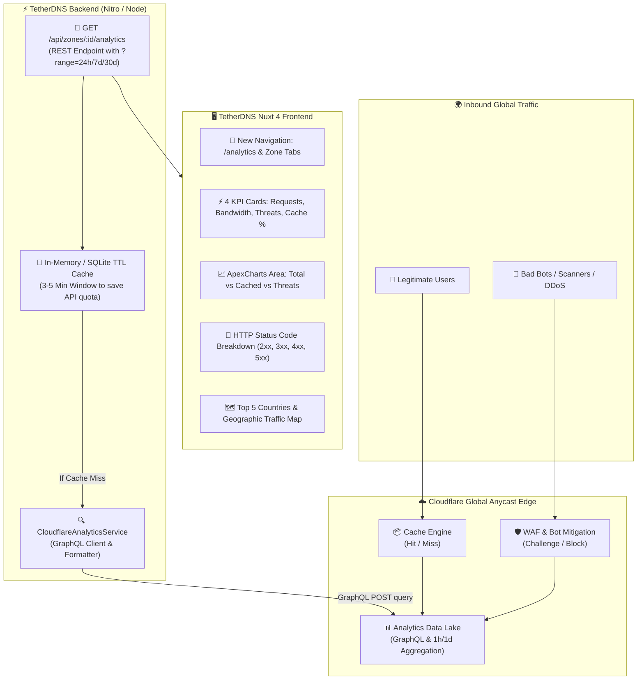

# 📊 TetherDNS: Cloudflare Edge Analytics & Threat Metrics Implementation Plan

แผนงานการพัฒนาเชิงลึกสำหรับการสร้างระบบ **Cloudflare Edge Analytics & Threat Metrics** ให้กับ **TetherDNS** เพื่อดึงข้อมูลโทรมาตรการใช้งานเครือข่ายและสถิติความปลอดภัยระดับโลกจาก Cloudflare Global Edge มาประมวลผลและแสดงผลแบบเรียลไทม์ผ่านแดชบอร์ดสไตล์ Cyberpunk ภายในแพลตฟอร์ม

---

## 📑 สารบัญ (Table of Contents)
1. [เป้าหมายและประโยชน์ของฟีเจอร์ (Goals & Value Proposition)](#1-เป้าหมายและประโยชน์ของฟีเจอร์)
2. [สถาปัตยกรรมระบบและการไหลของข้อมูล (System Architecture)](#2-สถาปัตยกรรมระบบและการไหลของข้อมูล)
3. [ตัวชี้วัดหลักที่จะนำมาแสดงผล (Core Metrics & KPIs)](#3-ตัวชี้วัดหลักที่จะนำมาแสดงผล)
4. [การเชื่อมต่อ Cloudflare GraphQL & REST Analytics API](#4-การเชื่อมต่อ-cloudflare-graphql--rest-analytics-api)
5. [การออกแบบ Backend API & Caching Layer](#5-การออกแบบ-backend-api--caching-layer)
6. [การออกแบบ Frontend Page & Interactive UI](#6-การออกแบบ-frontend-page--interactive-ui)
7. [การรองรับ Cloudflare Free Plan vs Paid Tier & ข้อจำกัด](#7-การรองรับ-cloudflare-free-plan-vs-paid-tier)
8. [แผนการดำเนินงานและขั้นตอนการพัฒนา (Phase Breakdown)](#8-แผนการดำเนินงานและขั้นตอนการพัฒนา)

---

## 1. เป้าหมายและประโยชน์ของฟีเจอร์

ผู้ใช้งานโฮมแล็บและเซิร์ฟเวอร์ส่วนตัวมักเปิดใช้งาน Cloudflare Proxy (ก้อนเมฆสีส้ม ☁️) เพื่อซ่อน IP บ้านและป้องกันการโจมตี แต่ปัจจุบันใน TetherDNS ยังมองไม่เห็นว่า:
- มีคนพยายามยิงหรือสแกนพอร์ตเซิร์ฟเวอร์เรามากน้อยเพียงใด?
- ทราฟฟิกส่วนใหญ่มาจากประเทศไหน?
- ทราฟฟิกถูกแคช (Cache Hit Ratio) ไปกี่เปอร์เซ็นต์ ช่วยประหยัดแบนด์วิดท์เน็ตบ้านได้เท่าใด?
- มีการโจมตีหรือ Bad Bot ที่ถูก Cloudflare WAF บล็อกไว้กี่ครั้ง?

**ฟีเจอร์นี้จะช่วย:**
* ให้ผู้ดูแลระบบเห็นภาพรวมทราฟฟิกจริงระดับ Edge ของทุกโดเมนในที่เดียวโดยไม่ต้องล็อกอินเข้า Cloudflare Dashboard
* ตรวจจับความผิดปกติ เช่น ทราฟฟิกพุ่งสูงผิดปกติ (Spike), ข้อผิดพลาด HTTP 5xx (เซิร์ฟเวอร์ปลายทางล่ม), หรือการโจมตีจากต่างประเทศ
* วัดประสิทธิภาพการแคชเพื่อปรับปรุงการส่งข้อมูลให้เร็วยิ่งขึ้น

---

## 2. สถาปัตยกรรมระบบและการไหลของข้อมูล



---

## 3. ตัวชี้วัดหลักที่จะนำมาแสดงผล (Core Metrics & KPIs)

### 3.1. Overview KPIs (การ์ดสรุป 4 ตัวบนหัวหน้า)
1. **Total Requests (จำนวนคำขอทั้งหมด):**
   * ยอดรวม Requests พร้อมแสดงเปอร์เซ็นต์เปรียบเทียบกับรอบก่อนหน้า
2. **Threats Mitigated (การโจมตี/บอทที่ถูกบล็อก):**
   * จำนวนครั้งที่ Cloudflare WAF / Security สกัดกั้นไว้ได้ (Challenge, Block, JS Challenge)
3. **Bandwidth / Data Transfer (ปริมาณข้อมูล):**
   * ปริมาณดาต้าทั้งหมดที่ส่งผ่าน (MB / GB) พร้อมแยกเป็น Bandwidth ที่ประหยัดได้จาก Cache
4. **Cache Hit Ratio (อัตราการแคชสำเร็จ):**
   * คำนวณเป็นเปอร์เซ็นต์ `(Cached Requests / Total Requests) * 100`

### 3.2. Time-Series Chart (กราฟแนวโน้มตามช่วงเวลา)
* กราฟเส้น/พื้นที่คู่ขนาน (Interactive Multi-Series Area Chart):
  * **เส้นเขียวนีออน:** Total Requests
  * **เส้นฟ้าไซอัน:** Cached Requests (ทราฟฟิกที่ Cloudflare ตอบแทนเซิร์ฟเวอร์เรา)
  * **เส้นแดงนีออน:** Threats / Blocked Requests (การโจมตีที่ถูกสกัดไว้)
* เลือกระยะเวลาย้อนหลังได้: **Last 24 Hours** (ข้อมูลรายชั่วโมง), **Last 7 Days** (รายวัน), **Last 30 Days** (รายวัน)

### 3.3. Threat & Security Breakdown (วิเคราะห์ภัยคุกคาม)
* การแยกประเภท Action: **Block**, **Managed Challenge**, **JS Challenge**
* การจัดอันดับ Top Threat Sources หรือ Top Countries ที่เป็นแหล่งที่มาของ Bad Traffic

### 3.4. HTTP Status Code Distribution (สุขภาพการตอบกลับ)
* กราฟ Donut สรุปสถานะ HTTP:
  * `2xx Success` (สีเขียว)
  * `3xx Redirection` (สีฟ้า)
  * `4xx Client Errors` เช่น 404, 403 (สีส้ม)
  * `5xx Origin Errors` เช่น 502 Bad Gateway, 504 Timeout (สีแดง)

### 3.5. Geographic Traffic (ทราฟฟิกรายประเทศ)
* ตาราง Top 5 - 10 ประเทศต้นทาง พร้อมรหัสประเทศ ธงชาติ จำนวน Request และสัดส่วน %

---

## 4. การเชื่อมต่อ Cloudflare GraphQL & REST Analytics API

Cloudflare แนะนำให้ดึงข้อมูลผ่าน **GraphQL Analytics API** (`https://api.cloudflare.com/client/v4/graphql`) ซึ่งมีความยืดหยุ่นสูงและให้ข้อมูลที่แม่นยำที่สุด:

### ตัวอย่าง GraphQL Query:
```graphql
query ZoneAnalytics($zoneTag: string!, $since: string!, $until: string!) {
  viewer {
    zones(filter: { zoneTag: $zoneTag }) {
      httpRequests1hGroups(
        limit: 1000
        filter: { datetime_geq: $since, datetime_leq: $until }
        orderBy: [datetime_ASC]
      ) {
        dimensions {
          datetime
        }
        sum {
          requests
          cachedRequests
          bytes
          cachedBytes
          threats
          pageviews
        }
        uniq {
          uniques
        }
      }
      httpRequestsAdaptiveGroups(
        limit: 10
        filter: { datetime_geq: $since, datetime_leq: $until }
        orderBy: [count_DESC]
      ) {
        count
        dimensions {
          clientCountryName
        }
      }
    }
  }
}
```

> **Fallback Strategy:** หากผู้ใช้มี API Token ที่เปิดสิทธิ์เฉพาะ REST Endpoint ทั่วไป ระบบจะมี Fallback อัตโนมัติไปที่ `GET /zones/:zone_id/analytics/dashboard` ของ Cloudflare REST API v4 เพื่อให้ยังคงแสดงผลสถิติภาพรวมได้แม้ไม่มีสิทธิ์ GraphQL เต็มรูปแบบ

---

## 5. การออกแบบ Backend API & Caching Layer

### 5.1. โครงสร้างไฟล์ Backend
* `server/services/CloudflareAnalyticsService.ts`: คลาสจัดการเรียก GraphQL/REST API, ประกอบ Query, และจัดรูป JSON ให้ Frontend ใช้งานง่าย
* `server/api/zones/[id]/analytics.get.ts`: Endpoint หลักสำหรับดึงสถิติประจำโซน รับ query parameter:
  * `timeRange`: `24h` (default), `7d`, `30d`
  * `refresh`: `true` (บังคับล้างแคชเพื่อดึงสด)
* `server/api/analytics/overview.get.ts`: รวมสถิติทุกโซนในระบบมาแสดงภาพรวมในหน้าแดชบอร์ดหลัก

### 5.2. การจัดการ Cache (Rate Limit & Cost Optimization)
* ข้อมูล Analytics บน Cloudflare อัปเดตช้ากว่าข้อมูลปกติ (มีดีเลย์ 1-5 นาที)
* สร้างระบบ In-Memory TTL Cache (อายุ 3 นาที) สำหรับผลลัพธ์แต่ละ Query:
  * หากเรียกซ้ำภายใน 3 นาที จะส่งข้อมูลจากแคชทันที (Response Time < 10ms)
  * มีปุ่ม `[Refresh]` บน UI ให้ผู้ใช้กดเพื่อส่ง `?refresh=true` ดึงข้อมูลสดจาก Cloudflare ได้เมื่อต้องการ

---

## 6. การออกแบบ Frontend Page & Interactive UI

### 6.1. จุดเชื่อมต่อบน UI (Where users can view it)
1. **หน้าแดชบอร์ดรวมใหม่ `/analytics`:**
   * เพิ่มปุ่มใน Sidebar Navigation เมนู **Analytics** (ไอคอน `i-heroicons-chart-bar`)
   * มี Dropdown ให้เลือกสลับดูทีละโดเมน หรือดูภาพรวมทั้งหมด (All Domains Aggregate)
2. **แท็บ Analytics ในหน้าโซน `/zones/[id]`:**
   * เพิ่มปุ่มลัด **"Analytics"** บนแถบเครื่องมือของหน้า `/zones/[id]` เพื่อเปิดดูสถิติของโดเมนนั้นได้ทันทีในคลิกเดียว

### 6.2. ดีไซน์ Cyberpunk Palette
* ใช้ดีไซน์สอดคล้องกับ TetherDNS Core:
  * พื้นหลัง Card ผิวกระจก (`var(--surface)`) เส้นขอบนีออนบาง (`var(--border)`)
  * กราฟสีเขียวนีออน (`#12e08a`), สีฟ้าไซอัน (`#2dd4ee`), และสีส้มอำพัน (`#f59e0b`)
  * Badge ตัวเลข Threats สีแดงนีออน (`#fb5e7a`)
  * รองรับทั้ง **Dark Mode** คมชัด และ **Light Mode** สะอาดตา

---

## 7. การรองรับ Cloudflare Free Plan vs Paid Tier

| หมวดหมู่สถิติ | Cloudflare Free Plan | Pro / Business / Enterprise |
| :--- | :--- | :--- |
| **ความละเอียดข้อมูล (Granularity)** | รายชั่วโมง (ย้อนหลัง 24 ชม.), รายวัน (ย้อนหลัง 30 วัน) | รายนาที / รายชั่วโมง (ย้อนหลัง 30 วัน) |
| **ประวัติย้อนหลัง (Retention)** | สูงสุด 30 วัน | สูงสุด 30 วัน (Pro) ถึงหลายเดือน |
| **Threats Breakdown** | แสดงยอด Threats รวม และ Top Countries | ละเอียดระดับ Rule ID และ Attack Vector |
| **การรองรับใน TetherDNS** | **รองรับ 100%** (ออกแบบให้ทำงานบน Free Tier ได้อย่างสมบูรณ์แบบ) | **รองรับเต็มความสามารถ** |

---

## 8. แผนการดำเนินงานและขั้นตอนการพัฒนา

### ขั้นตอนที่ 1: Backend Service & GraphQL Client
1. สร้าง `server/services/CloudflareAnalyticsService.ts` พร้อมฟังก์ชันยิง GraphQL API
2. ทำฟังก์ชัน Fallback ไปยัง REST Analytics API ในกรณีที่ GraphQL โดนจำกัดสิทธิ์
3. พัฒนา `server/api/zones/[id]/analytics.get.ts` พร้อมระบบ TTL In-Memory Cache (3 นาที)

### ขั้นตอนที่ 2: Frontend Data Visualization Components
1. สร้างคอมโพเนนต์ `app/components/analytics/OverviewCards.vue` สำหรับ KPI 4 ใบ
2. สร้างคอมโพเนนต์ `app/components/analytics/TrafficTimeSeriesChart.vue` (ApexCharts Area Chart สไตล์ Cyberpunk)
3. สร้างคอมโพเนนต์ `app/components/analytics/StatusCodeDonut.vue` และ `TopCountriesTable.vue`
4. สร้างคอมโพเนนต์ `app/components/analytics/ThreatWidget.vue`

### ขั้นตอนที่ 3: Routing & Page Integration
1. สร้างหน้าเพจใหม่ `app/pages/analytics/index.vue`
2. เพิ่มแท็บ/ปุ่มเปิด Analytics ในหน้า `app/pages/zones/[id].vue`
3. เพิ่มเมนู **Analytics** ในแถบเมนูด้านซ้ายและในส่วน Mobile Navigation
4. อัปเดตไฟล์ภาษา `en.json` และ `th.json`

### ขั้นตอนที่ 4: การทดสอบและการรับรอง (Verification & Hardening)
1. ทดสอบกับโดเมนที่มีทราฟฟิกจริง และโดเมนที่เพิ่งสร้างใหม่ (Empty State / Zero Traffic)
2. ตรวจสอบการแสดงผล Dark / Light Mode และ Responsive บนหน้าจอมือถือ
3. ตรวจสอบ Error Handling ในกรณี Token ขาดสิทธิ์ Analytics
4. รัน `npx nuxi prepare` และ `npm run build` ตรวจสอบความถูกต้อง 100%
