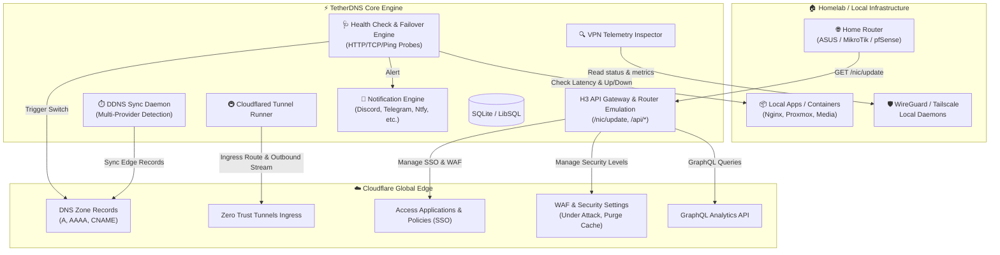
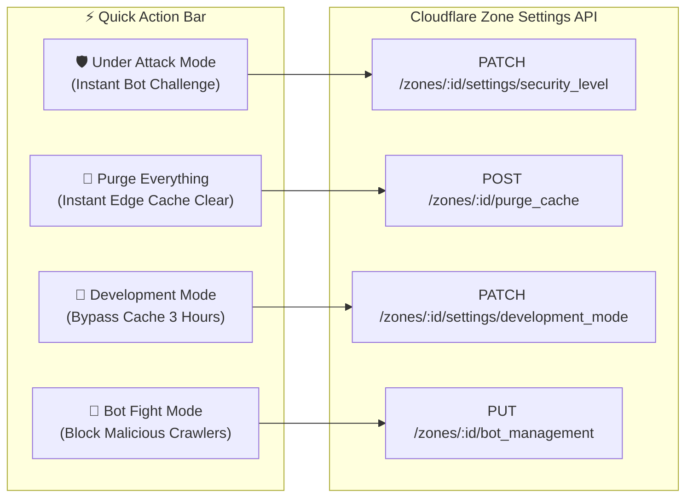
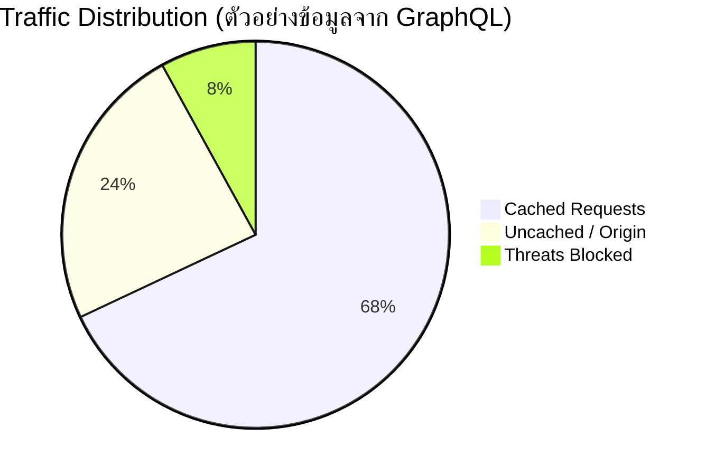
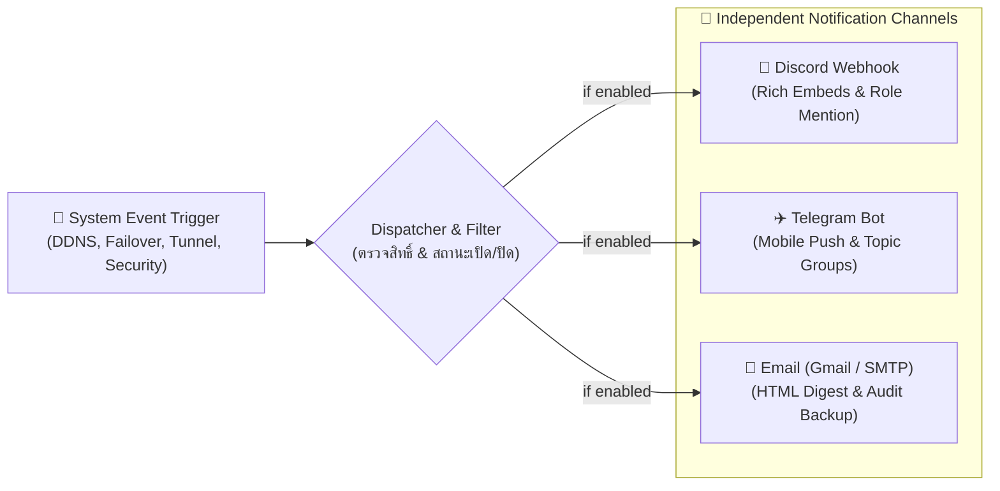
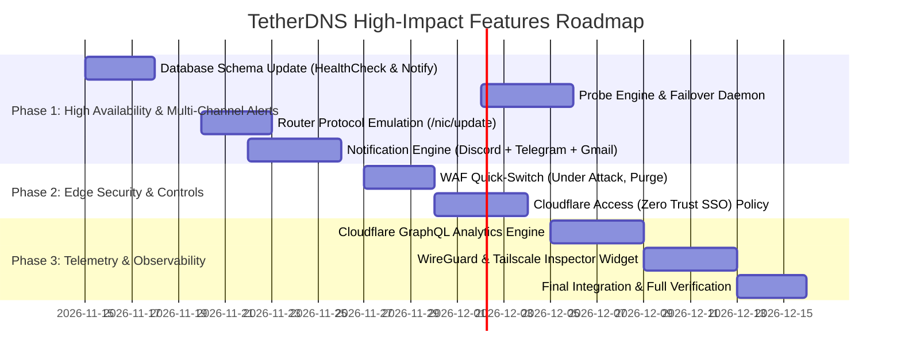

# 🚀 TetherDNS Feature Implementation Plan (แผนการพัฒนาฟีเจอร์ระดับละเอียด)

เอกสารนี้เป็นแผนการพัฒนาเชิงลึก (Implementation Plan) สำหรับการเพิ่มขีดความสามารถของ **TetherDNS** จากระบบ Dynamic DNS & Cloudflare Tunnel Manager ก้าวขึ้นสู่ **Edge & Homelab Orchestration Platform** ที่สมบูรณ์แบบ ทั้งในด้านความพร้อมใช้งานสูง (High Availability), ความสะดวกในการเชื่อมต่อกับเราเตอร์, ระบบรักษาความปลอดภัย Zero Trust, การมอนิเตอร์เครือข่าย และระบบแจ้งเตือนอัจฉริยะ

---

## 📑 สารบัญ (Table of Contents)
1. [ภาพรวมสถาปัตยกรรมระบบ (System Architecture & Data Flow)](#1-ภาพรวมสถาปัตยกรรมระบบ)
2. [Feature 1: Service Health Check & Automatic IP Failover](#2-feature-1-service-health-check--automatic-ip-failover)
3. [Feature 2: Router Standard Protocol Emulation (`/nic/update`)](#3-feature-2-router-standard-protocol-emulation-nicupdate)
4. [Feature 3: Cloudflare Access (Zero Trust SSO) Policy Integration](#4-feature-3-cloudflare-access-zero-trust-sso-policy-integration)
5. [Feature 4: Security & WAF Quick-Switch (Quick Controls)](#5-feature-4-security--waf-quick-switch-quick-controls)
6. [Feature 5: Native WireGuard / Tailscale Status Widget](#6-feature-5-native-wireguard--tailscale-status-widget)
7. [Feature 6: Cloudflare Analytics & Threat Metrics](#7-feature-6-cloudflare-analytics--threat-metrics)
8. [Feature 7: Enhanced Discord Webhook & ข้อเสนอช่องทางแจ้งเตือนยอดนิยม](#8-feature-7-enhanced-discord-webhook--ข้อเสนอช่องทางแจ้งเตือนยอดนิยม)
9. [แผนการดำเนินงานทีละเฟส (Phased Roadmap & Milestones)](#9-แผนการดำเนินงานทีละเฟส-phased-roadmap--milestones)

---

## 1. ภาพรวมสถาปัตยกรรมระบบ



---

## 2. Feature 1: Service Health Check & Automatic IP Failover

### 2.1 วัตถุประสงค์และการทำงาน
ให้ TetherDNS ทำหน้าที่เป็น **Active-Passive / Multi-WAN DNS Failover Controller** โดยคอยตรวจสอบความพร้อมของบริการปลายทาง (HTTP Status, TCP Port หรือ ICMP Ping) หากเซิร์ฟเวอร์หลักหรือเน็ตบ้านหลักล่ม จะสลับ A/AAAA Record ไปยัง Backup IP หรือหน้า Static Maintenance อัตโนมัติ และเมื่อบริการหลักกลับมาเป็นปกติ จะสลับคืน (Auto-Failback) ให้อย่างราบรื่น

### 2.2 โครงสร้างฐานข้อมูล (Prisma Schema Updates)
```prisma
model HealthCheck {
    id                 Int         @id @default(autoincrement())
    recordId           Int         @unique
    record             DnsRecord   @relation(fields: [recordId], references: [id], onDelete: Cascade)
    enabled            Boolean     @default(true)
    probeType          String      @default("HTTP") // "HTTP" | "TCP" | "PING"
    probeTarget        String      // URL e.g. "https://app.riixch.com/healthz" or "192.168.1.50:8080"
    expectedStatus     Int?        @default(200)   // For HTTP check
    intervalSeconds    Int         @default(60)    // 15, 30, 60, 300
    timeoutSeconds     Int         @default(5)
    failureThreshold   Int         @default(3)     // Consecutive failures before failover
    successThreshold   Int         @default(2)     // Consecutive successes before failback
    
    // Failover target
    backupIp           String      // Backup IP (IPv4/IPv6) or Static Fallback IP
    backupProxied      Boolean     @default(true)
    
    // Live runtime state
    currentStatus      String      @default("HEALTHY") // "HEALTHY" | "DEGRADED" | "DOWN" | "FAILOVER_ACTIVE"
    consecutiveFails   Int         @default(0)
    consecutivePasses  Int         @default(0)
    lastCheckAt        DateTime?
    lastFailoverAt     DateTime?
    lastLatencyMs      Int?
    autoFailback       Boolean     @default(true)
    
    history            HealthCheckLog[]
}

model HealthCheckLog {
    id            Int         @id @default(autoincrement())
    healthCheckId Int
    healthCheck   HealthCheck @relation(fields: [healthCheckId], references: [id], onDelete: Cascade)
    status        String      // "PASS" | "FAIL"
    statusCode    Int?
    latencyMs     Int
    errorMessage  String?
    createdAt     DateTime    @default(now())
}
```

### 2.3 ขั้นตอนการพัฒนา (Backend & Engine)
1. **Probe Engine (`server/services/ProbeService.ts`):**
   * **HTTP/HTTPS Probe:** ตรวจสอบ Response Status Code, Response Time และรองรับ SSL Validation Bypass (สำหรับ Internal Self-Signed Certs)
   * **TCP Port Probe:** ใช้ Node.js `net.Socket` ลองเชื่อมต่อ Port เพื่อตรวจสอบความพร้อมของ Database / Game Server / Custom Service
   * **Latency Tracker:** บันทึก RTT (Round Trip Time) เพื่อนำไปพล็อตกราฟ Latency ใน UI
2. **Failover Execution Daemon (`server/plugins/healthcheck.ts`):**
   * รัน Background Scheduler ตรวจสอบตาม `intervalSeconds`
   * Logic ป้องกัน **Flapping:** ต้องผิดพลาดติดต่อกันครบ `failureThreshold` ถึงจะยิงคำสั่ง Edit DNS Record บน Cloudflare
   * เมื่อสลับเป็น Backup IP -> ส่ง Notification แจ้งเตือนระดับ Critical ทันที
   * เมื่อระบบหลักกลับมาออนไลน์และผ่าน `successThreshold` -> ปรับ Record กลับสู่ Primary IP พร้อมแจ้งเตือน Recovery
3. **API Endpoints:**
   * `POST /api/records/:id/healthcheck` (สร้างหรือตั้งค่า Healthcheck)
   * `GET /api/records/:id/healthcheck/history` (ดูประวัติ Uptime & Latency)
   * `POST /api/records/:id/healthcheck/test` (ทดสอบยิง Probe แบบ Manual)
   * `POST /api/records/:id/healthcheck/toggle-failover` (สลับ Failover ด้วยมือ)

### 2.4 หน้าบ้าน (Frontend UI)
* เพิ่มแท็บ **"Health & Failover"** ใน `RecordEditModal.vue`
* ในหน้ารายละเอียดโซน `/zones/[id]` เพิ่ม Badge แสดงสถานะ `● HEALTHY (34ms)` หรือ `▲ FAILOVER ACTIVE`
* Modal แสดงกราฟประวัติ Latency และเปอร์เซ็นต์ Uptime 24 ชม.

---

## 3. Feature 2: Router Standard Protocol Emulation (`/nic/update`)

### 3.1 วัตถุประสงค์และการทำงาน
เราเตอร์ส่วนใหญ่ตามบ้านและองค์กร (เช่น ASUS, MikroTik RouterOS, pfSense, OPNsense, UniFi, Synology, Keenetic, OpenWrt) มีระบบ Dynamic DNS ในตัวที่ใช้โปรโตคอลมาตรฐานของ **DynDNS v2 / No-IP** การเปิด Endpoint `/nic/update` จะทำให้ผู้ใช้เพียงแค่นำ URL ของ TetherDNS ไปใส่ในช่อง DDNS ของเราเตอร์ แล้วอัปเดต IP ได้ทันทีโดยไม่ต้องลงสคริปต์เสริม

### 3.2 มาตรฐานโปรโตคอล DynDNS v2 Spec
* **URL:** `GET /nic/update?hostname=<domain>&myip=<ip>`
* **Headers:** รองรับ HTTP Basic Auth `Authorization: Basic base64(username:password)`
* **Credentials ใน TetherDNS:**
  * `username`: ชื่อ User ใน TetherDNS หรือ API Token Name
  * `password`: รหัสผ่าน User หรือ API Access Token หรือ Record DDNS Token
* **Standard Return Codes:**
  * `good <ip>` : อัปเดตสำเร็จ
  * `nochg <ip>` : IP ไม่มีการเปลี่ยนแปลง (Already up to date)
  * `badauth` : ข้อมูลยืนยันตัวตนไม่ถูกต้อง
  * `nohost` : ไม่พบ Hostname นี้ในระบบ
  * `abuse` : ส่งคำขอถี่เกินไป (Rate limit)
  * `911` : ข้อผิดพลาดฝั่งเซิร์ฟเวอร์

### 3.3 การพัฒนา Backend (`server/routes/nic/update.ts`)
```ts
// server/routes/nic/update.ts
export default defineEventHandler(async (event) => {
    setHeader(event, 'Content-Type', 'text/plain')
    
    // 1. ตรวจสอบ Basic Auth Header
    const auth = parseBasicAuth(event)
    if (!auth) return 'badauth'

    // 2. ตรวจสอบผู้ใช้หรือ API Token
    const isValid = await validateRouterCredentials(auth.user, auth.pass)
    if (!isValid) return 'badauth'

    // 3. รับพารามิเตอร์
    const query = getQuery(event)
    const hostname = query.hostname as string
    const detectedIp = (query.myip as string) || getRequestIP(event, { xForwardedFor: true })

    if (!hostname) return 'notfqdn'

    // 4. ค้นหา DNS Record ในระบบ
    const record = await prisma.dnsRecord.findFirst({
        where: { name: hostname },
        include: { zone: { include: { account: true } } }
    })
    if (!record) return 'nohost'

    // 5. ดำเนินการอัปเดต
    if (record.content === detectedIp) {
        return `nochg ${detectedIp}`
    }

    await updateCloudflareAndDatabase(record, detectedIp)
    return `good ${detectedIp}`
})
```

---

## 4. Feature 3: Cloudflare Access (Zero Trust SSO) Policy Integration

### 4.1 วัตถุประสงค์และการทำงาน
เมื่อสร้าง Subdomain ชี้ไปยัง Home Server ผ่าน Cloudflare Tunnel (เช่น `vaultwarden.domain.com` หรือ `proxmox.domain.com`) หากเปิดออกเน็ตโดยตรงอาจเสี่ยงต่อการถูกสแกนเจาะ ฟีเจอร์นี้จะช่วยให้สามารถเปิด **Cloudflare Access Application** ได้ด้วยคลิกเดียวจาก TetherDNS เพื่อบังคับให้ผู้ใช้งานต้องยืนยันตัวตนด้วย **Email OTP, Google หรือ GitHub** ก่อนถึงจะเปิดหน้าเว็บได้

### 4.2 Cloudflare API Integration
* **List Identity Providers:** `GET /accounts/{cfAccountId}/access/identity_providers`
* **Create Access App:** `POST /accounts/{cfAccountId}/access/apps`
  * Body: `{ name, domain, session_duration: "24h" }`
* **Create Access Policy:** `POST /accounts/{cfAccountId}/access/apps/{appId}/policies`
  * Rules: Allow emails (เช่น `user@gmail.com`) หรือ Email Domains (เช่น `@company.com`)

### 4.3 โครงสร้างฐานข้อมูล
```prisma
model AccessProtection {
    id             Int       @id @default(autoincrement())
    recordId       Int       @unique
    record         DnsRecord @relation(fields: [recordId], references: [id], onDelete: Cascade)
    cfAppId        String    @unique
    name           String
    allowedEmails  String    // JSON array: ["admin@example.com"]
    sessionDuration String   @default("24h")
    createdAt      DateTime  @default(now())
}
```

### 4.4 หน้าบ้าน (Frontend UI)
* ใน Modal ของ Tunnel Record เพิ่มสวิตช์ **"Enable Cloudflare Access (SSO)"**
* แสดงช่องให้ใส่ Email Whitelist ที่อนุญาตให้ล็อกอิน
* แสดง Badge รูปแม่กุญแจ `[🔒 SSO PROTECTED]` หน้ารายชื่อ Record

---

## 5. Feature 4: Security & WAF Quick-Switch (Quick Controls)

### 5.1 วัตถุประสงค์และการทำงาน
รวมศูนย์ปุ่มควบคุมความปลอดภัยของ Cloudflare Zone ให้อยู่บนหน้า Dashboard และหน้ารายละเอียดโซน `/zones/[id]` เพื่อให้ผู้ดูแลระบบสามารถรับมือกับเหตุฉุกเฉินได้ทันทีโดยไม่ต้องเปิดหลายแท็บบน Cloudflare Dashboard



### 5.2 รายละเอียดฟังก์ชัน
1. **Under Attack Mode Toggle:** สลับ Security Level เป็น `under_attack` ทันทีเมื่อเว็บไซต์ถูก DDoS หรือ Brute-force
2. **Purge Cache Button:** ล้าง Edge Cache ของ Cloudflare ทั้งหมด หรือเลือกเฉพาะ Hostname
3. **Development Mode Toggle:** ปิด Cache ชั่วคราว 3 ชม. เพื่อทดสอบหน้าเว็บ
4. **Browser Integrity Check:** ป้องกัน HTTP Request ที่ส่ง Header ผิดปกติหรือบอทไร้หัว (Headless Browsers)

---

## 6. Feature 5: Native WireGuard / Tailscale Status Widget

### 6.1 วัตถุประสงค์และการทำงาน
สำหรับ Homelab และเซิร์ฟเวอร์ส่วนใหญ่ มักจะรัน Cloudflare Tunnel ควบคู่ไปกับ VPN เช่น **Tailscale** หรือ **WireGuard** เพื่อการเข้าถึงเครือข่ายส่วนตัว การมี Status Widget แสดงผลบน TetherDNS จะช่วยให้เห็นภาพรวมของเครือข่ายทั้งหมดในที่เดียว

### 6.2 การตรวจจับและดึงข้อมูล (Local Telemetry)
* **Tailscale:**
  * ดึงข้อมูลผ่าน Local API Socket: `GET /localapi/v0/status` (หรือรัน `tailscale status --json`)
  * ข้อมูลที่นำมาแสดง: Node IP (`100.x.y.z`), MagicDNS FQDN, สถานะ Online/Offline, จำนวน Peers ที่เชื่อมต่อ, Exit Node Status
* **WireGuard:**
  * ตรวจสอบคำสั่ง `wg show --json` หรือคำนวณผ่าน interface `/sys/class/net/wg0/`
  * ข้อมูลที่นำมาแสดง: Interface Name, Public Key, Transfer Rx/Tx, Latest Handshake Timestamp

### 6.3 UI Widget
* วิดเจ็ตสไตล์ Cyberpunk บนหน้า `/tunnels` หรือ Dashboard แสดง Ping RTT, Network Throughput Meter และสถานะ Active Peers แบบ Real-time

---

## 7. Feature 6: Cloudflare Analytics & Threat Metrics

### 7.1 วัตถุประสงค์และการทำงาน
ดึงสถิติทราฟฟิกจริงจาก Cloudflare GraphQL Analytics API มาแสดงเป็น Dashboard สวยงามและรวดเร็ว โดยแคชข้อมูลลงฐานข้อมูลเพื่อประหยัด Rate Limit



### 7.2 ข้อมูลตัวชี้วัดที่จะแสดงผล
1. **Request Volume (24h / 7d):** กราฟแท่งเปรียบเทียบคำขอทั้งหมด vs คำขอที่ติดแคช (Cache Hit Ratio)
2. **Bandwidth Savings:** ขนาดข้อมูลที่ประหยัดได้จาก Edge Caching (เช่น ประหยัดแบนด์วิธต้นทางไป 78%)
3. **Threats Blocked Count:** จำนวนการโจมตีหรือบอทที่ถูกระบบ Cloudflare สกัดกั้น
4. **Top 5 Visitor Countries:** แสดงธงชาติและจำนวนคำขอจากประเทศที่มีการเรียกดูสูงสุด
5. **Status Code Breakdown:** สัดส่วนของคำขอ 2xx, 3xx, 4xx และ 5xx

---

## 8. Feature 7: Multi-Channel Notification Engine (Discord, Telegram, Gmail & Modular Config)

### 8.1 สถาปัตยกรรมแบบแยกอิสระ (Fully Modular & Optional Architecture)
หัวใจสำคัญของระบบแจ้งเตือนใหม่ใน TetherDNS คือ **ความยืดหยุ่นและการทำงานแบบแยกส่วนโดยสมบูรณ์ (Zero-Dependency & Multi-Channel)**:
* **ไม่ตั้งค่าเลยก็ได้ (Silent Mode):** ผู้ใช้สามารถปิดการแจ้งเตือนทั้งหมดได้ 100% โดยระบบจะทำงานอัตโนมัติตามปกติ และบันทึกข้อมูลเฉพาะใน `UpdateLog` และ `AuditLog`
* **เลือกเปิดแค่อันใดอันหนึ่งก็ได้ (Single Channel):** เช่น เปิดเฉพาะ Telegram สำหรับแจ้งเตือนเข้ามือถือส่วนตัว หรือเปิดเฉพาะ Discord เข้าห้องเซิร์ฟเวอร์
* **เปิดใช้งานพร้อมกันทั้งหมดก็ได้ (Multi-Channel):** ระบบจะยิงแจ้งเตือนแบบคู่ขนาน (Parallel Dispatch via `Promise.allSettled`) หากช่องทางใดช่องทางหนึ่งมีปัญหา (เช่น Discord เกิด Rate limit ชั่วคราว) จะไม่กระทบต่อการส่งข้อความไปยัง Telegram หรือ Email
* **แยกประเภทเหตุการณ์ที่ต้องการรับได้อิสระในแต่ละช่องทาง (Granular Event Routing):**
  * 🔄 **DDNS Updates:** แจ้งเตือนเมื่อตรวจพบการเปลี่ยนแปลง Public IP
  * 🚨 **Failover Events:** แจ้งเตือนวิกฤตเมื่อ Health Check ล่มและสลับไป Backup IP
  * 🟢 **Recovery Events:** แจ้งเตือนเมื่อบริการหลักกลับมาออนไลน์และสลับ IP คืน
  * 🚇 **Tunnel State:** แจ้งเตือนเมื่อ Cloudflare Tunnel Daemon หลุดหรือเชื่อมต่อใหม่
  * 🛡️ **Security Alerts:** แจ้งเตือนเมื่อเปิด Under Attack Mode หรือมีการล็อกอินแอดมินใหม่

---

### 8.2 รายละเอียด 3 ช่องทางหลักที่คัดสรร



#### 1. Discord Webhook (Enhanced Cyberpunk Embeds)
* **การตั้งค่า:**
  * `Webhook URL` (จำเป็น)
  * `Bot Username` (ปรับแต่งได้ เช่น "TetherDNS Guardian")
  * `Avatar URL` (ปรับแต่งไอคอนบอทได้)
  * `Mention Role ID` (ไม่บังคับ: ใส่ Role ID เช่น `<@&1122334455>` เพื่อให้ Discord ส่งเสียงเตือนเฉพาะเหตุการณ์วิกฤต Failover)
* **รูปแบบข้อความ:** Rich Embed สไตล์ Cyberpunk แบ่งฟิลด์ชัดเจน (Domain, Old IP ➔ New IP, Latency, Trigger Type) พร้อมแถบสีสถานะ (เขียวนีออน / ส้มแอมเบอร์ / แดงวิกฤต)

#### 2. Telegram Bot (Instant & Lightweight Mobile Push)
* **ทำไมถึงเหมาะ:** เป็นช่องทางที่ชาว Homelab และ SysAdmin นิยมสูงสุด ส่งฟรี ไม่มีค่าใช้จ่าย และแจ้งเตือนผ่านมือถือได้ทันที
* **การตั้งค่า:**
  * `Bot Token` (ขอได้ฟรีจาก `@BotFather` บน Telegram)
  * `Chat ID` (รองรับทั้งแชตส่วนตัว และ Group ID ติดลบ เช่น `-100123456789`)
  * `Message Thread ID / Topic ID` (ไม่บังคับ: สำหรับ Supergroup ที่เปิดแบ่งห้อง Topics)
  * `Silent Notification Toggle` (ส่งแบบไม่ส่งเสียงเตือน สำหรับการอัปเดต IP ประจำวัน)
* **รูปแบบข้อความ:** จัดหน้าด้วย HTML Formatting พร้อม Emoji สถานะ สรุปเหตุการณ์กระชับ และแนบลิงก์คลิกเปิด TetherDNS Dashboard ได้จากในแชต

#### 3. Email Notification (รองรับ Gmail 1-Click Preset & Custom SMTP)
* **ทำไมถึงเหมาะ:** เหมาะสำหรับเก็บบันทึกประวัติ (Audit Archive) และส่งรายงานสรุปให้ทีมงาน
* **โหมดที่ 1: Gmail Preset (ใช้งานง่ายที่สุด):**
  * ติ๊กเลือก "Gmail Provider" ระบบจะล็อกค่า Host เป็น `smtp.gmail.com` และ Port `465` (SSL) ให้อัตโนมัติ
  * ผู้ใช้เพียงระบุ **Gmail Address** และ **Google App Password** (รหัสผ่านสำหรับแอป 16 หลัก ไม่ต้องปิด 2-Factor Authentication ของ Google)
* **โหมดที่ 2: Custom SMTP:**
  * สลับเป็น Custom เพื่อเชื่อมต่อกับ Mail Server อื่นได้ เช่น Postmark, Brevo (Sendinblue), AWS SES, Synology MailPlus หรือเซิร์ฟเวอร์เมลส่วนตัว
* **รูปแบบอีเมล:** Responsive HTML Template สะอาดตา มีโลโก้ TetherDNS แสดงตารางสรุปสถานะการสลับ IP และปุ่ม Call-to-Action เพื่อตรวจสอบ Edge Records

---

### 8.3 โครงสร้างฐานข้อมูลสำหรับระบบแจ้งเตือนใหม่

```prisma
model NotificationChannel {
    id          Int      @id @default(autoincrement())
    type        String   // "discord" | "telegram" | "email" | "webhook"
    label       String   // e.g. "Discord Alerts", "My Telegram", "Admin Gmail"
    enabled     Boolean  @default(true)
    
    // Encrypted config JSON
    // Discord: { webhookUrl, botName, avatarUrl, mentionRole }
    // Telegram: { botToken, chatId, topicId, silentMode }
    // Email: { provider: "gmail"|"custom", host, port, secure, user, pass, toAddress }
    config      String
    
    // Event Filter Subscriptions (JSON array: ["DDNS", "FAILOVER", "TUNNEL", "SECURITY"])
    events      String   @default("[\"DDNS\",\"FAILOVER\",\"TUNNEL\",\"SECURITY\"]")
    
    lastUsedAt  DateTime?
    createdAt   DateTime @default(now())
}
```

---

## 9. แผนการดำเนินงานทีละเฟส (Phased Roadmap & Milestones)



### สรุปแผนส่งมอบ:
* **Phase 1 (Core Reliability & Modular Alerts):**
  * พัฒนาระบบ **Health Check Failover** ป้องกันระบบล่ม
  * เปิด Endpoint **`/nic/update`** สำหรับเราเตอร์ทุกค่าย
  * พัฒนาระบบแจ้งเตือน 3 ช่องทางอิสระ: **Enhanced Discord Webhook**, **Telegram Bot** และ **Email (พร้อม Gmail Preset)** สามารถเปิด/ปิดอันไหนก็ได้ตามความต้องการ
* **Phase 2 (Edge Security):** เสริมแกร่งความปลอดภัยด้วย **WAF Controls** และ **Cloudflare Access SSO**
* **Phase 3 (Observability):** ดึงสถิติเชิงลึก **Cloudflare GraphQL** และสถานะ **VPN WireGuard/Tailscale** มาแสดงผลอย่างครบวงจร
